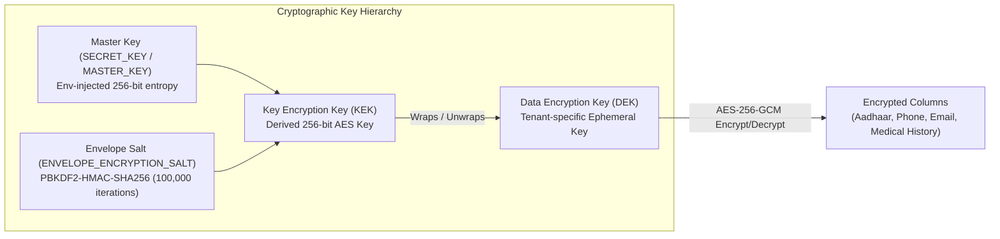

# Avinya HMS – Master System Architecture & Technical Specification
## High-Level & Low-Level Design (HLD & LLD)

**Repository:** `sai1-crypto/avinya_hms`  
**Current Milestone Version:** `v2.0.0-ENTERPRISE` (Commit [`e2fbd09`](file:///v:/avinya_hms) on `main`, PR #125)  
**Test Suite Verification:** 441 Passed, 2 Skipped (100% Green across 63 test suites), 0 Bandit High/Medium, 0 pip-audit CVEs  
**Target Environment:** Multi-Tenant Healthcare Enterprise (Cloud / Hybrid On-Premises)  
**Document Classification:** Engineering Architecture Specification & Technical Handover  
**Date:** 26 October 2026  

---

## 1. Executive Summary & Architectural Mission

**Avinya HMS** is an enterprise-grade, multi-tenant Hospital Management System designed to handle mission-critical clinical, financial, surgical, diagnostic, and administrative workflows for hospital networks, corporate healthcare conglomerates, and independent facilities.

### Core Architectural Pillars
1. **Strict Multi-Tenancy & Data Isolation:** Database-per-tenant physical isolation (`hms_{tenant_slug}`) combined with a centralized SaaS Control Plane (`hms_control_plane`).
2. **ACID Compliance & Clinical Safety:** Strict database constraint modeling, cross-encounter clinical decision support (Drug-Drug Interactions), and atomic bed/inventory reservation.
3. **Statutory & Regulatory Alignment:** Native support for India's **Digital Personal Data Protection (DPDP) Act 2023**, **Goods and Services Tax (GST)** invoicing, **Statutory Payroll (PF, ESI, TDS, PTax)**, and **Biomedical Waste (BMW)** tracking.
4. **Defense-in-Depth Security:** Column-level AES-256-GCM envelope encryption, Argon2id/TOTP authentication, operator RBAC, SSRF defenses, and production surface lockdown.
5. **Operational Resilience:** Redis-backed task queue with dry-run controls, automated pre-restore database snapshots, and off-host S3 disaster recovery with cryptographic sidecars.

---

## 2. Macro Architecture & System Topology

Avinya HMS is structured as a **Modular Monolith with an Autonomous Fleet Control Plane**. This architectural pattern avoids the distributed latency, network unreliability, and eventual-consistency failure modes of microservices in clinical environments while guaranteeing strict separation between hospital tenant data and platform fleet orchestration.

```mermaid
flowchart TD
    subgraph CLIENTS["Edge Clients & Operators"]
        OP_USER["Hospital Group Operator / Superadmin"]
        STAFF_USER["Clinical Staff (Doctors, Nurses, Pharmacists, Billing)"]
        SIEM_SCRAPER["SIEM / Prometheus Telemetry Collector"]
    end

    subgraph EDGE["Ingress & Edge Security Layer"]
        REVERSE_PROXY["Traefik / NGINX Ingress Controller<br/>(TLS Termination & Host Header Routing)"]
        CORS_FILTER["CORS & Request Correlation Middleware<br/>(X-Request-ID Tracking)"]
        METRICS_AUTH["Telemetry Scrape Token Gate<br/>(Constant-Time Bearer Verification)"]
    end

    subgraph APPS["Dual ASGI Application Tier"]
        subgraph CONTROL_PLANE_APP["Nexus Fleet Control Plane (:8080)"]
            CP_CORE["backend/control_plane/app.py"]
            CP_ROUTERS["Fleet Ops, Provisioning, Catalogs, Saas Billing"]
            CP_RBAC["Operator RBAC (superadmin, ops, support, billing, viewer)"]
            CP_SAN["Sandbox Sanitizer (100% Schema Classified)"]
            CP_AUDIT_GUARD["Audit Immutability Hook (before_update/delete Guard)"]
        end

        subgraph TENANT_APP["Hospital Tenant API Engine (:8000)"]
            MAIN_CORE["backend/main.py (Root & /v1 Mount)"]
            ROUTER_POOL["24 Domain Routers with License Gate (RequireLicensedModule)"]
            ENVELOPE_ENGINE["Envelope Encryption Engine (AES-256-GCM)"]
            DDI_ENGINE["Cross-Encounter DDI Engine"]
            PRIVACY_ENGINE["DPDP Consent, Rights & Breach Register"]
        end
    end

    subgraph DATA_TIER["State & Persistence Tier"]
        CP_DB[(Control Plane DB<br/>hms_control_plane)]
        TENANT_POOL[(Multi-Tenant Engine Pool<br/>hms_{tenant_slug} Databases)]
        REDIS_NODE[(Redis 8 Cluster<br/>Queues, Rate Limits, PubSub)]
        WORKER_SVC["Background Queue Worker<br/>(1h TTL, Dry-Run Sweeps)"]
        S3_STORAGE[("Off-Host S3 DR Storage<br/>(SSE-S3/KMS + SHA-256 Sidecars)")]
    end

    CLIENTS --> EDGE
    REVERSE_PROXY --> CORS_FILTER
    CORS_FILTER --> CP_CORE
    CORS_FILTER --> MAIN_CORE
    SIEM_SCRAPER --> METRICS_AUTH --> MAIN_CORE

    CP_CORE --> CP_RBAC --> CP_SAN --> CP_DB
    CP_CORE --> CP_AUDIT_GUARD --> CP_DB
    CP_CORE -.->|Fleet Maintenance| TENANT_POOL

    MAIN_CORE --> ROUTER_POOL
    ROUTER_POOL --> ENVELOPE_ENGINE
    ROUTER_POOL --> DDI_ENGINE
    ROUTER_POOL --> PRIVACY_ENGINE
    ROUTER_POOL --> TENANT_POOL
    MAIN_CORE --> REDIS_NODE

    WORKER_SVC --> REDIS_NODE
    WORKER_SVC --> TENANT_POOL
    TENANT_POOL -.-> S3_STORAGE
```

---

## 3. Ingress, Request Lifecycle & Middleware Pipeline

Every HTTP transaction entering the application passes through a deterministic sequence of middleware guards:

```
Incoming Request
  │
  ▼
[1. Request Correlation Middleware]
  ├─ Reads or generates X-Request-ID (UUID v4 or safe client token)
  ├─ Binds request ID to contextvars.ContextVar for unified cross-library logging
  └─ Sets start-timer for microsecond execution latency tracking
  │
  ▼
[2. CORS & Header Hardening]
  ├─ Restricts origins via settings.CORS_ORIGINS
  ├─ Allows credentials, methods (GET, POST, PUT, PATCH, DELETE, OPTIONS)
  └─ Injects security headers and validates allowed custom headers
  │
  ▼
[3. Surface Lockdown & Documentation Gate]
  ├─ If ENVIRONMENT == "production" and not ENABLE_PRODUCTION_API_DOCS:
  │    Blocks /docs, /redoc, /openapi.json (returns 404 Not Found)
  └─ Enforces Bearer token scrape verification on /metrics
  │
  ▼
[4. Tenant Resolution & Engine Routing]
  ├─ Inspects request Host header / subdomain (or X-Hospital-Subdomain override)
  ├─ Queries Control Plane registry cache for active tenant status
  ├─ Obtains isolated SQLAlchemy connection engine from TenantEnginePool
  └─ Binds session to request.state.db
  │
  ▼
[5. Modular License & Role Dependency Checks]
  ├─ Verifies JWT bearer signature against tenant secret key
  ├─ Evaluates user roles against domain requirement (RequireLicensedModule)
  └─ Enforces Operator RBAC if targeting Control Plane endpoints
  │
  ▼
[6. Domain Business Execution]
  ├─ ACID transactions, envelope column decryption, DDI/GST checks
  └─ ORM audit listeners automatically attach created_by / updated_by
  │
  ▼
[7. Unified Exception & Response Handling]
  ├─ Maps SQLAlchemy IntegrityError -> 409 Conflict / 400 Bad Request
  ├─ Maps SQLAlchemy OperationalError / lock timeouts -> 409 Retry
  ├─ Sanitizes unhandled exceptions -> 500 JSON without stack-trace leakage
  └─ Injects X-Request-ID and X-Process-Time-Ms headers
```

---

## 4. Low-Level Design (LLD): Comprehensive Domain Breakdown

The system organizes clinical, operational, and financial functions into **24 cohesive domain packages** under [`backend/domains/`](file:///v:/avinya_hms/backend/domains) and the **SaaS Control Plane** under [`backend/control_plane/`](file:///v:/avinya_hms/backend/control_plane):

### 4.1 Identity, IAM & Access Control ([`backend/domains/identity`](file:///v:/avinya_hms/backend/domains/identity))
- **Responsibilities:** User authentication, password hashing, session tracking, role assignment, and multi-factor authentication.
- **Key Models:** `User`, `Role`, `UserRole`, `AuthSession`, `DoctorProfile`, `Department`.
- **Security Mechanics:**
  - Password hashing via `Argon2id` (with pre-computed bcrypt caching for test speed).
  - RFC 6238 TOTP engine (`pyotp`) for privileged multi-factor authentication.
  - Emergency admin password reset (`POST /tenants/{slug}/reset-admin-password`) immediately purges `auth_sessions`, clears `password_reset_tokens`, and advances `password_changed_at` to invalidate existing JWTs.
- **Break-Glass Emergency Protocol (`break_glass_router.py`):** Enables authorized emergency clinicians to bypass normal patient confidentiality barriers during critical life-threatening events, creating high-priority immutable audit trails.

### 4.2 Multi-Tenancy & Dynamic Routing ([`backend/core/database.py`](file:///v:/avinya_hms/backend/core/database.py))
- **Responsibilities:** Managing connection pools and routing incoming requests to isolated databases.
- **Key Components:** `TenantEnginePool`, `get_db`, `get_control_db`, `ControlSessionLocal`.
- **Isolation Guarantees:** Each hospital tenant resides in a discrete PostgreSQL database prefixed with `hms_` (e.g., `hms_apollo`, `hms_manipal`).
- **Engine Lifecycle:** Engine instances are cached, bounded, and disposed cleanly during application shutdown via the FastAPI lifespan context manager.

### 4.3 Master Patient Index & Demographics ([`backend/domains/patients`](file:///v:/avinya_hms/backend/domains/patients))
- **Responsibilities:** Patient registration, demographic updates, medical record numbers (MRN), and cross-hospital pointer resolution.
- **Key Models:** `Patient`, `PatientConsentRecord`, `EmergencyContact`.
- **Envelope Encryption:** PII fields (Aadhaar, national IDs, contact numbers, email addresses) are encrypted at rest using AES-256-GCM.
- **Audited MPI Lookup:** Cross-tenant search (`/mpi/lookup`) is strictly restricted to `support` and `superadmin` operators and requires a mandatory `justification` parameter (minimum 10 characters) permanently recorded in `ControlPlaneAuditLog`.

### 4.4 Outpatient Department (OPD) & Appointments ([`backend/domains/encounters/opd_router.py`](file:///v:/avinya_hms/backend/domains/encounters))
- **Responsibilities:** Outpatient consultation queues, token generation, specialty clinic scheduling, and doctor consult status tracking (`SCHEDULED` -> `CHECKED_IN` -> `IN_CONSULTATION` -> `COMPLETED`).
- **Key Models:** `OPDQueueEntry`, `Appointment`, `ConsultationNote`.

### 4.5 Inpatient ADT (Admission, Discharge, Transfer) ([`backend/domains/encounters/adt_router.py`](file:///v:/avinya_hms/backend/domains/encounters), [`facility`](file:///v:/avinya_hms/backend/domains/facility))
- **Responsibilities:** Inpatient admission orders, bed census management, ward transfers, and multi-department discharge clearance.
- **Key Models:** `InpatientAdmission`, `Ward`, `Room`, `Bed`, `BedAllocationHistory`.
- **Discharge Gate Automation:** Prevents patient discharge until three mandatory conditions are met:
  1. Clinical discharge summary completed by attending physician.
  2. Pharmacy clearance confirming no pending unreturned medications.
  3. Billing clearance confirming zero outstanding balance or authorized financial indemnity.

### 4.6 Clinical Decision Support, CPOE & NEWS2 Deterioration Alerts ([`backend/domains/clinical`](file:///v:/avinya_hms/backend/domains/clinical))
- **Responsibilities:** EMR documentation (SOAP notes), clinical problem lists, allergy tracking, CPOE standardized order sets, NEWS2 physiological deterioration scoring, drug-disease contraindications, and cross-encounter DDI checks.
- **Key Models:** `ClinicalNote`, `Prescription`, `PrescriptionItem`, `PatientAllergy`, `OrderSet`, `ClinicalEarlyWarningScore`.
- **CPOE Order Sets:** Standardized evidence-based protocol bundles (`OrderSet`) that atomically generate multi-disciplinary medication, laboratory, and radiology orders.
- **NEWS2 Deterioration Alerts:** Real-time scoring across 6 physiological parameters (respiration rate, SpO2, supplemental oxygen, systolic BP, pulse, consciousness/temperature) with immediate emergency escalation to Rapid Response Teams (RRT) for scores >= 7.
- **Drug-Disease Contraindications:** Cross-references prescribed generic molecules against patient active ICD-10 diagnoses (e.g. Beta-blockers in Bronchial Asthma `J45`, NSAIDs in Peptic Ulcer `K27`).
- **DDI Engine Specification:**
  - Evaluates active prescriptions across **all encounters** (both past and active admissions/OPDs) for the patient.
  - Enforces generic token length validation (`len >= 3` and whitespace rejection) to prevent false hard stops on unmapped drug names.
  - Interaction severities: `CRITICAL_HARD_STOP` (blocks submission), `MAJOR_WARNING` (requires physician clinical override justification), and `MODERATE_INFO`.

### 4.7 Diagnostic Laboratory Information System (LIS) & Delta Checking ([`backend/domains/diagnostics`](file:///v:/avinya_hms/backend/domains/diagnostics))
- **Responsibilities:** Pathology and diagnostic test ordering, specimen collection, result entry, reference ranges, automated numeric delta checks, and critical panic alerts.
- **Key Models:** `ServiceCategory`, `ServiceCatalog`, `DiagnosticOrder`, `DiagnosticTask`.
- **LIS Delta Checking:** Evaluates acute variations between current result and prior historic baseline over a retrospective time window, flagging potential hemolyzation or IV fluid contamination.
- **Panic Value Alerting:** Critical values (e.g., severe hypokalemia, extreme troponin elevation) trigger automated immediate alerts to attending doctors and ward dashboards.
- **Two-Tier Verification:** Phlebotomist/technician entry is isolated from senior pathologist verification and digital sign-off.

### 4.8 Radiology PACS & Imaging Metadata ([`backend/domains/bloodbank`](file:///v:/avinya_hms/backend/domains/bloodbank))
- **Responsibilities:** Imaging study orders (X-ray, CT, MRI, Ultrasound), modality worklist integration, and DICOM viewer deep-linking.
- **Key Models:** `RadiologyStudyMetadata`, `RadiologyStudyAttachment`.
- **Integration:** Secure URL generation for Web-based DICOM viewers with ephemeral token-authenticated viewing sessions.

### 4.9 Pharmacy Management, BCMA 5-Rights & Controlled Substances Vault ([`backend/domains/pharmacy`](file:///v:/avinya_hms/backend/domains/pharmacy))
- **Responsibilities:** Medication catalog, stock receipt, batch-expiry management, FEFO dispensation, bedside Barcode Medication Administration (BCMA) 5-rights verification, and Schedule H/X perpetual narcotics vault.
- **Key Models:** `PharmacyItem`, `PharmacyBatch`, `MedicationDispense`, `PharmacyReturn`, `BCMAScanAuditLog`, `ControlledSubstanceMovementLog`.
- **BCMA 5-Rights Verification:** Bedside barcode validation confirming Right Patient, Right Drug, Right Dose, Right Route, and Right Time with strict hard stops on mismatches.
- **Schedule H/X Perpetual Vault:** Double-locked perpetual inventory and dual-witness digital co-signatures for dispensation and wastage logging.
- **FEFO Logic:** Dispensation algorithms prioritize batches with the nearest expiration date while preventing dispensation of expired lots.

### 4.10 Billing, Multi-Tariff CDM, Midnight Census & GST Engine ([`backend/domains/billing`](file:///v:/avinya_hms/backend/domains/billing))
- **Responsibilities:** Chargemaster (CDM) automation, multi-tariff MoU rate card resolution, automated inpatient midnight census billing, invoice generation, statutory GST calculation, discount authorization, and AR aging.
- **Key Models:** `Invoice`, `InvoiceLineItem`, `Payment`, `AdvanceDeposit`, `ChargeCaptureEvent`, `InsurancePlanTariff`.
- **Multi-Tariff MoU Engine:** Resolves negotiated insurance rates and enforces statutory daily room rent caps.
- **Midnight Census Runner:** Automated daily midnight charge capture for occupied beds, nursing fees, and recurring care with idempotent `source_reference` deduplication.
- **GST Invoicing:**
  - Automated calculation of CGST, SGST, and IGST based on hospital location and patient state of residence.
  - Net discount validation includes statutory taxes (`new_net = (total_amount_paise + tax_amount_paise) - discount_amount_paise`).
  - AR Aging buckets (0-30, 31-60, 61-90, 90+ days) strictly incorporate tax liabilities in analytical balance queries.
- **Document Persistence:** PDF generation with cryptographic timestamping via `xhtml2pdf`.

### 4.11 Insurance, TPA & Pre-Authorization ([`backend/domains/insurance`](file:///v:/avinya_hms/backend/domains/insurance))
- **Responsibilities:** Third-Party Administrator (TPA) policy verification, pre-authorization requests, claim submissions, and co-payment calculations.
- **Key Models:** `InsuranceProvider`, `PatientInsurancePolicy`, `InsurancePreAuthRequest`, `InsuranceClaim`.

### 4.12 Operation Theatre & Surgery ([`backend/domains/surgery`](file:///v:/avinya_hms/backend/domains/surgery))
- **Responsibilities:** OT scheduling, surgical team allocation, Pre-Anesthetic Checkup (PAC) clearance, and intra-operative nursing checklists.
- **Key Models:** `OperatingTheatre`, `SurgeryBooking`, `PreAnestheticCheckup`, `SurgicalChecklist`.

### 4.13 Blood Bank Management ([`backend/domains/bloodbank`](file:///v:/avinya_hms/backend/domains/bloodbank))
- **Responsibilities:** Voluntary donor registration, blood component separation (PRBC, FFP, Platelets), ABO/Rh compatibility testing, and cross-matching.
- **Key Models:** `BloodDonor`, `BloodComponentUnit`, `CrossMatchRequest`.

### 4.14 Emergency Room & Medico-Legal Cases (ER/MLC) ([`backend/domains/clinical`](file:///v:/avinya_hms/backend/domains/clinical))
- **Responsibilities:** Emergency triage categorization (Red/Yellow/Green), trauma care documentation, police notifications, and MLC forensics registers.
- **Key Models:** `ERTriageAssessment`, `MedicoLegalCase`.

### 4.15 Statutory Payroll & Workforce Management ([`backend/domains/workforce`](file:///v:/avinya_hms/backend/domains/workforce))
- **Responsibilities:** Staff attendance tracking, salary profiles, statutory deduction calculation (PF, ESI, TDS, Professional Tax), and finalized payroll locking.
- **Key Models:** `EmployeeProfile`, `SalaryProfile`, `AttendanceRecord`, `PayrollPeriod`, `PayrollLine`.
- **Audit Lockout:** Finalized payroll periods are locked against modification; unlocking requires elevated credentials and generates audit logs.

### 4.16 Biomedical Waste Management ([`backend/domains/service_ops`](file:///v:/avinya_hms/backend/domains/service_ops))
- **Responsibilities:** Tracking hazardous biomedical waste by color categories (Yellow, Red, White, Blue) per statutory environmental guidelines.
- **Key Models:** `BiomedicalWasteLog`, `WasteDisposalManifest`.

### 4.17 Health Data Federation & FHIR R4 ([`backend/domains/federation`](file:///v:/avinya_hms/backend/domains/federation), [`fhir`](file:///v:/avinya_hms/backend/domains/fhir))
- **Responsibilities:** Inter-hospital record queries within corporate groups and FHIR R4 standard serialization.
- **Key Models:** `FederationNode`, `FederatedConsentToken`.
- **Corporate Group Routing:** Pattern-matching with regex support (`re.split` verified) allows flexible hospital codes (e.g., `CORP-HYD-01`, `CORP_BLR_02`).

### 4.18 Data Privacy & DPDP Act 2023 Compliance ([`backend/domains/privacy`](file:///v:/avinya_hms/backend/domains/privacy))
- **Responsibilities:** Purpose-specific consent tracking, patient data rights requests (Access, Correction, Erasure), and data breach incident logging.
- **Key Models:** `ConsentArtifact`, `PatientDataRightsRequest`, `PrivacyDataBreachIncident`, `PrivacyDecisionAudit`.
- **Breach Forensics:** Captures incident severity, affected demographic categories, and timestamps of notifications to data protection authorities.

### 4.19 Hospital Support Services ([`backend/domains/service_ops`](file:///v:/avinya_hms/backend/domains/service_ops))
- **Responsibilities:** Operational logistics covering Ambulance fleet dispatch, Dietary meal planning, Central Sterile Services Department (CSSD) autoclave tracking, and Mortuary management.
- **Key Models:** `AmbulanceTrip`, `DietaryOrder`, `CSSDAutoclaveBatch`, `MortuaryRegister`.

### 4.20 Analytics & Executive BI ([`backend/domains/analytics`](file:///v:/avinya_hms/backend/domains/analytics))
- **Responsibilities:** Executive hospital KPIs: Bed Occupancy Rate (BOR), Average Length of Stay (ALOS), departmental revenue trends, and AR aging matrices.

### 4.21 Finance & Accounts Payable ([`backend/domains/finance`](file:///v:/avinya_hms/backend/domains/finance))
- **Responsibilities:** Vendor invoice intake, payment vouchers, 3-way matching with procurement receipts, and general ledger journal entries.

### 4.22 Procurement & Supply Chain ([`backend/domains/procurement`](file:///v:/avinya_hms/backend/domains/procurement))
- **Responsibilities:** Purchase requisitions, Purchase Orders (PO), Goods Receipt Notes (GRN), and supplier performance catalogs.

### 4.23 Realtime Events & WebSockets ([`backend/domains/realtime`](file:///v:/avinya_hms/backend/domains/realtime))
- **Responsibilities:** Live telemetry broadcasting, bed status updates, emergency code announcements, and doctor notification channels over Redis Pub/Sub.

### 4.24 Native HL7 v2 MLLP Receiver & Equipment Test Mappings ([`backend/domains/integrations`](file:///v:/avinya_hms/backend/domains/integrations))
- **Responsibilities:** Native TCP/MLLP socket listener on port 2575, unsolicited `ORU^R01` observation result parsing, equipment-to-catalog test mappings, automated delta checking, and panic alert broadcasting.
- **Key Models:** `EquipmentMaster`, `HL7IntegrationLog`, `EquipmentTestMapping`.

### 4.25 ABDM (M1-M3) & NHCX National Health Claims Gateway ([`backend/domains/abdm`](file:///v:/avinya_hms/backend/domains/abdm))
- **Responsibilities:** Ayushman Bharat Digital Mission (ABDM) ABHA profile creation/linking (M1), consent artifact management and revocations (M2), FHIR R4 Encounter/DiagnosticReport bundle packaging (M3), and National Health Claims Exchange (NHCX) claim dispatch and adjudication logging.
- **Key Models:** `ABDMConsentArtefact`, `NHCXClaimExchangeLog`.

### 4.26 Hospital Quality Indicators (NABH 5th Ed / JCI 7th Ed) & Incident Register ([`backend/domains/quality`](file:///v:/avinya_hms/backend/domains/quality))
- **Responsibilities:** Automated computation of hospital-acquired infection benchmarks (CAUTI, CLABSI, VAP, SSI), inpatient fall rates, medication errors, and unplanned ICU/OT returns; adverse incident register with root cause analysis (RCA) and CAPA tracking.
- **Key Models:** `ClinicalQualityIncident`, `QualityIndicatorBenchmark`.

### 4.27 SaaS Control Plane & Fleet Orchestrator ([`backend/control_plane`](file:///v:/avinya_hms/backend/control_plane))
- **Responsibilities:** Multi-tenant provisioning, subscription billing, blueprint seeding, key rotation, database cloning, and sandbox sanitization.
- **Key Services:**
  - `auth.py`: Operator session authentication and role validation.
  - `sandbox_sanitizer.py`: Automated 100% database table classification (`MASTER_AND_CONFIG_TABLES`, `PURGED_LOG_TABLES`, `SCRUBBED_DATA_TABLES`) with credential erasure and synthetic clinical data masking.
  - `models.py`: Immutable `ControlPlaneAuditLog` protected by ORM event listeners.

---

## 5. Security & Cryptographic Architecture



### Security Safeguards
1. **AES-256-GCM Envelope Encryption:** Personal identifying data is encrypted using column-level authenticated Galois/Counter Mode. Key rotation script (`rotate_envelope_keys.py`) enables zero-downtime key migration.
2. **SSRF Guard:** Webhook outbound testers (`audit/router.py`) resolve target hosts via `socket.getaddrinfo` and reject RFC 1918 private subnets, loopback (`127.0.0.1`), link-local (`169.254.0.0/16`), and AWS/GCP cloud metadata endpoints.
3. **Metrics Protection:** Prometheus scraping (`/metrics`) enforces constant-time comparison against `METRICS_SCRAPE_TOKEN`.
4. **Production Surface Lockdown:** API documentation routes (`/docs`, `/redoc`, `/openapi.json`) are completely disabled in production environments (`ENABLE_PRODUCTION_API_DOCS=False`).

---

## 6. Asynchronous Queue & Background Worker Architecture

```mermaid
sequenceDiagram
    autonumber
    participant API as FastAPI Tenant API
    participant R as Redis 8 (broker)
    participant W as Worker Daemon (backend/worker.py)
    participant DB as PostgreSQL 17 (Tenant DB)

    API->>R: LPUSH task payload (JSON serialized, signed)
    Note over API,R: No Python pickle used; safe JSON schemas only
    W->>R: BRPOP task queue
    R-->>W: Deliver task
    W->>W: Evaluate task type & safeguards
    alt Task is privacy.retention.execute
        Note over W: Enforces dry_run=True for scheduled worker runs
        W->>DB: Scan expired retention records (dry-run mode)
        DB-->>W: Return candidate count (no destructive deletion)
    end
    W->>R: HDEL payload & set result with 1-hour TTL
    Note over R: Sensitive payloads scrubbed from memory
```

- **Retention Safety:** Worker retention runs are hardcoded to `dry_run=True`. Manual destructive execution requires explicit environment variable `PRIVACY_ALLOW_RETENTION_EXECUTE=True`, two-person separation of duties (`creator != executor`), and signed approval reference.
- **Payload Hygiene:** Redis memory footprint is maintained by immediately deleting task input payloads upon completion and reducing result TTL to 1 hour.

---

## 7. Disaster Recovery & Business Continuity

1. **Off-Host S3 Delivery:** Real `boto3` client multi-part upload with server-side encryption (SSE-S3 / SSE-KMS), verification read-back, and SHA-256 sidecar checksum generation.
2. **Automated Pre-Restore Safety Snapshots:** The database restore endpoint automatically triggers an immutable pre-restore snapshot of the target database before any destructive restore operation.
3. **Hardened Restore Drill Automation:** Automated drills (`backend/scripts/restore_drill.py`) validate backup restorable integrity into ephemeral databases matching `^drill_[a-zA-Z0-9_]+$`, URL-encode PostgreSQL credentials, and measure Recovery Point Objectives (RPO).

---

## 8. Front-End Onboarding UI Architecture

- **Technology:** React 18.3, Vite 8.3, TailwindCSS v4, React Flow visual blueprinting.
- **Responsibilities:** Zero-touch tenant provisioning, hospital blueprint catalog selection (e.g., Primary Clinic, Super-Specialty, Tertiary Hospital), pricing simulator, and live fleet management.
- **Production Asset Build:** Generates an optimized 415 kB JS bundle (123 kB gzip) with zero warnings, mounted directly at `/assets` and served by FastAPI in production.

---

## 9. CI/CD Release Gates & Verification

Every merge to `main` must pass four strict GitHub Actions release gates:
1. `Build onboarding UI`: Vite production build and Node.js test execution.
2. `Build production API image`: Multi-stage Docker container build with non-root security.
3. `Python tests and PostgreSQL 17 migrations`: 421 automated tests across 63 modules, plus Alembic multi-tenant migration application.
4. `Validate Compose configurations`: Compose schema and environment variable validation.
