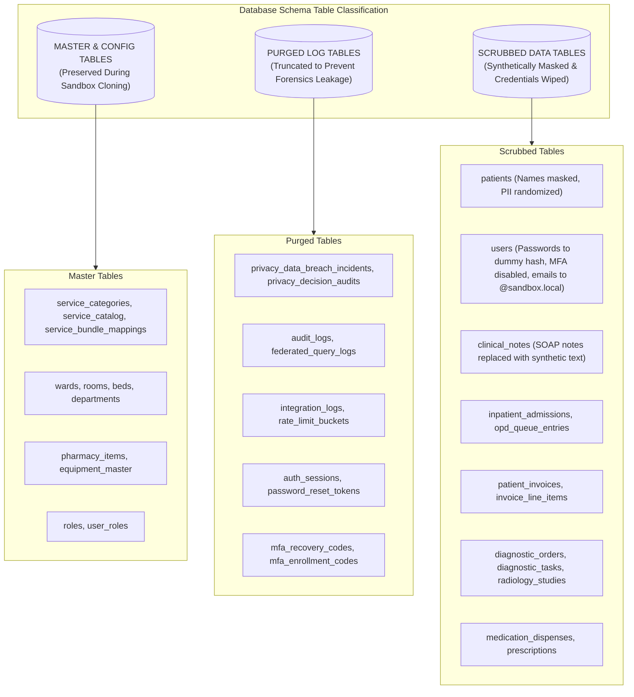

# Avinya HMS – System Inventory & Boundaries Specification
## What the System Contains vs. What it Does NOT Contain

**Repository:** `sai1-crypto/avinya_hms`  
**Milestone Version:** `v2.0.0-ENTERPRISE` (Commit [`e2fbd09`](file:///v:/avinya_hms) on `main`, PR #125)  
**Test Suite Verification:** 443 Passed, 2 Skipped (100% Green across 63 test suites), 0 Bandit High/Medium, 0 pip-audit CVEs  
**Document Classification:** Product & Technical Boundaries Specification  
**Date:** 26 October 2026  

---

## 1. Document Purpose & Scope

This document provides a strict, unambiguous definition of the architectural footprint of **Avinya HMS**. It serves as an authoritative reference for software engineering teams, solutions architects, security auditors, and product managers by explicitly delineating:
1. **What the system contains:** Every implemented, tested, and certified subsystem, database table, API interface, and operational automation.
2. **What the system does NOT contain:** Components that are intentionally out of scope, shelved per stakeholder directive, or deferred to future project phases.

---

## 2. Comprehensive Inventory of What the System Contains

### 2.1 Backend Application & API Surface (Hospital Engine)
The core backend application is built using **Python 3.11** and **FastAPI**, with database access governed by **SQLAlchemy 2.1** and data validation enforced by **Pydantic v2**. The application exposes **both root routes (`/api/...`) and versioned routes (`/v1/api/...`)** across **26 modular healthcare domains**:

| Domain Package | File Location | Key Capabilities & Endpoints |
| :--- | :--- | :--- |
| **Identity & IAM** | [`backend/domains/identity`](file:///v:/avinya_hms/backend/domains/identity) | User authentication, password reset, Argon2id hashing, RFC 6238 TOTP MFA, session revocation, department assignments. |
| **Break-Glass** | [`backend/domains/patients/break_glass_router.py`](file:///v:/avinya_hms/backend/domains/patients) | Emergency clinical access override with mandatory forensic audit logging. |
| **Master Patient Index** | [`backend/domains/patients`](file:///v:/avinya_hms/backend/domains/patients) | Patient registration, Aadhaar/phone AES-256-GCM envelope encryption, demographic lookups, pincode locality suggestions. |
| **Outpatient (OPD)** | [`backend/domains/encounters/opd_router.py`](file:///v:/avinya_hms/backend/domains/encounters) | OPD queue triage, appointment booking, doctor assignment, consultation status transitions. |
| **Inpatient (IPD/ADT)** | [`backend/domains/encounters/adt_router.py`](file:///v:/avinya_hms/backend/domains/encounters) | Admission orders, bed census, inter-ward transfers, 3-tier discharge clearance gate (clinical, pharmacy, billing). |
| **Facility & Wards** | [`backend/domains/facility`](file:///v:/avinya_hms/backend/domains/facility) | Ward, room, and bed catalog management, bed state locks (`with_for_update(nowait=True)`). |
| **Clinical EMR, CPOE & CDS** | [`backend/domains/clinical`](file:///v:/avinya_hms/backend/domains/clinical) | SOAP notes, ICD-10 coding, CPOE order sets, NEWS2 physiological deterioration scoring, drug-disease contraindications, and cross-encounter DDI engine. |
| **Emergency & MLC** | [`backend/domains/clinical/nursing_er_router.py`](file:///v:/avinya_hms/backend/domains/clinical) | ER triage assessment (Red/Yellow/Green), trauma clinical documentation, Medico-Legal Case police registers. |
| **Vital Registries** | [`backend/domains/clinical/vital_registries_router.py`](file:///v:/avinya_hms/backend/domains/clinical) | Birth and death registries, cause-of-death certification, medical certificate generation. |
| **Diagnostic LIS** | [`backend/domains/diagnostics`](file:///v:/avinya_hms/backend/domains/diagnostics) | LOINC/CPT test orders, order bundles, specimen tracking, panic lab alerts, LIS numeric delta checking, pathologist two-tier sign-off. |
| **Radiology PACS** | [`backend/domains/bloodbank`](file:///v:/avinya_hms/backend/domains/bloodbank) | Imaging order tracking (CT, MRI, X-ray), DICOM viewer URL generation, radiologist impression reports. |
| **Pharmacy, BCMA & Vault**| [`backend/domains/pharmacy`](file:///v:/avinya_hms/backend/domains/pharmacy) | Medication catalog, FEFO dispensation, bedside BCMA 5-rights barcode verification, Schedule H/X perpetual vault with dual-witness wastage. |
| **Billing & Multi-Tariff CDM** | [`backend/domains/billing`](file:///v:/avinya_hms/backend/domains/billing) | Multi-tariff MoU rate cards, daily room rent caps, idempotent charge capture event ledger, automated midnight census runs, line-item GST. |
| **Insurance & TPA** | [`backend/domains/insurance`](file:///v:/avinya_hms/backend/domains/insurance) | TPA insurance policies, pre-authorization workflows, co-pay calculation, claim reconciliation. |
| **Surgery & OT** | [`backend/domains/surgery`](file:///v:/avinya_hms/backend/domains/surgery) | OT scheduling, surgical team rosters, Pre-Anesthetic Checkup (PAC) clearance, WHO surgical safety checklists. |
| **Blood Bank** | [`backend/domains/bloodbank`](file:///v:/avinya_hms/backend/domains/bloodbank) | Donor registry, component separation (PRBC, Platelets, FFP), cross-matching compatibility verification. |
| **Workforce & Payroll** | [`backend/domains/workforce`](file:///v:/avinya_hms/backend/domains/workforce) | Staff profiles, attendance logs, statutory payroll deductions (PF, ESI, TDS, PTax), locked period audit controls. |
| **Biomedical Waste** | [`backend/domains/service_ops/bmw_router.py`](file:///v:/avinya_hms/backend/domains/service_ops) | Color-coded biomedical waste categorization (Yellow, Red, White, Blue), generation/disposal manifests. |
| **Support Services** | [`backend/domains/service_ops`](file:///v:/avinya_hms/backend/domains/service_ops) | Ambulance dispatch, dietary meal planning, CSSD autoclave batch tracking, mortuary records. |
| **Health Federation** | [`backend/domains/federation`](file:///v:/avinya_hms/backend/domains/federation) | Inter-hospital query exchange, corporate-group branch regex matching (`re.split` verified), consent tokens. |
| **FHIR R4 Engine** | [`backend/domains/fhir`](file:///v:/avinya_hms/backend/domains/fhir) | Standards-compliant FHIR R4 JSON serialization for Patient, Encounter, Condition, and Observation resources. |
| **Privacy & DPDP** | [`backend/domains/privacy`](file:///v:/avinya_hms/backend/domains/privacy) | Purpose-specific consent capture, Data Subject Rights requests, breach notification register. |
| **Analytics & BI** | [`backend/domains/analytics`](file:///v:/avinya_hms/backend/domains/analytics) | Bed occupancy rates, departmental revenue trends, Accounts Receivable (AR) aging buckets (0-30, 31-60, 61-90, 90+). |
| **Finance & AP** | [`backend/domains/finance`](file:///v:/avinya_hms/backend/domains/finance) | Accounts payable, vendor invoices, payment vouchers, 3-way matching. |
| **Procurement & PO** | [`backend/domains/procurement`](file:///v:/avinya_hms/backend/domains/procurement) | Purchase requisitions, purchase orders, goods receipt notes (GRN), vendor catalogs. |
| **Realtime Streams** | [`backend/domains/realtime`](file:///v:/avinya_hms/backend/domains/realtime) | WebSocket connection manager, authenticated channel subscriptions, emergency broadcasts via Redis Pub/Sub. |
| **Equipment & HL7 MLLP** | [`backend/domains/integrations`](file:///v:/avinya_hms/backend/domains/integrations) | Native TCP/MLLP socket listener, unsolicited ORU^R01 parser, equipment test mappings, telemetry feeds. |
| **ABDM & NHCX Gateway** | [`backend/domains/abdm`](file:///v:/avinya_hms/backend/domains/abdm) | ABDM M1 (ABHA profile), M2 (Consent artifacts), M3 (FHIR R4 bundles), and NHCX claims exchange gateway. |
| **Quality & Accreditations**| [`backend/domains/quality`](file:///v:/avinya_hms/backend/domains/quality) | NABH 5th Ed & JCI 7th Ed quality indicators (CAUTI, CLABSI, VAP, SSI, Falls, Med Errors) and adverse incident CAPA register. |
| **Tenant Policies** | [`backend/domains/policies`](file:///v:/avinya_hms/backend/domains/policies) | Hospital operational rules, department directories, license entitlement enforcement. |
| **Audit Logging** | [`backend/domains/audit`](file:///v:/avinya_hms/backend/domains/audit) | SIEM audit log export with DNS-resolved SSRF protections, clinical access logs. |

---

### 2.2 SaaS Control Plane & Fleet Orchestrator ([`backend/control_plane`](file:///v:/avinya_hms/backend/control_plane))
The Control Plane operates as an independent administrative engine running on port 8080:
- **Tenant Registry & Routing:** Stores tenant metadata, slug mappings, database connection pointers, deployment modes (`CLOUD` vs `ON_PREM`), and maintenance status.
- **Operator RBAC:** Strict role governance enforcing `superadmin`, `ops`, `support`, `billing`, and `viewer` permissions.
- **Audited MPI Lookup:** Cross-tenant search requiring mandatory justification (minimum 10 characters) logged to `ControlPlaneAuditLog`.
- **Zero-Touch Provisioning:** Automated hospital provisioning from pre-configured blueprints (e.g., Primary Clinic, Super-Specialty, Tertiary Center).
- **Subscription Billing:** Stripe webhook integration with cryptographic signature verification (`construct_event`).
- **Database Cloning & Sandbox Sanitization (R-02):** Automated database cloning with 100% schema table classification, credential clearing, and synthetic data masking.
- **Immutable Audit Logging (R-09):** SQLAlchemy ORM event listeners (`before_update`, `before_delete`) enforcing append-only tamper-proof audit trails.

---

### 2.3 Database Schema Classification & Inventory
The platform maintains strict schema classification across **60+ database tables** to guarantee tenant isolation and sandbox sanitization:

---

### 2.4 Front-End Onboarding Web Console ([`onboarding-ui`](file:///v:/avinya_hms/onboarding-ui))
- **Framework:** React 18.3, TypeScript, Vite 8.3, TailwindCSS v4, React Flow.
- **Capabilities:**
  - Visual hospital blueprinting and departmental workflow designer.
  - Multi-tier SaaS pricing simulator and catalog selector.
  - Zero-touch hospital provisioning wizard.
  - Fleet management console displaying live tenant health, active bed census, and database sizes.
  - Migration Studio for legacy CSV imports with validation and duplicate detection.
- **Production Build:** Generates an optimized, self-contained 415 kB JS bundle (123 kB gzip) with zero external CDN dependencies.

---

### 2.5 Operational Automation & Disaster Recovery
- **Off-Host S3 Backups:** Real `boto3` multi-part upload with server-side encryption (SSE-S3 / SSE-KMS), verification read-back, and SHA-256 sidecar checksums.
- **Automated Pre-Restore Snapshots:** Guaranteed safety snapshot creation prior to any database restore operation.
- **Automated Restore Drills:** Disaster recovery validation script (`backend/scripts/restore_drill.py`) verifying backup restoration into ephemeral databases.
- **Background Worker & Redis Queue:** Safe JSON serialization, 1-hour Redis TTL, payload purging, and hardcoded `dry_run=True` retention sweeps.
- **Observability:** Authenticated Prometheus metrics endpoint (`/metrics`) and JSON structured logging with unified `X-Request-ID` correlation.

---

## 3. Explicit Specification of What the System Does NOT Contain

To prevent scope creep and maintain architectural clarity, the following components are **explicitly NOT included** in the current release:

### 3.1 Shelved Frontend Interfaces (Per Stakeholder Directive)
1. **Tenant-Facing Hospital Clinical UI:**
   - *Status:* **Shelved / Out of Scope.**
   - *Description:* There is **no nurse station dashboard, doctor consultation screen, pharmacy counter UI, or billing desk UI** in this repository.
   - *Rationale:* Per explicit instruction, all tenant-facing frontend development is strictly shelved until backend and onboarding plane certification is complete. The backend exposes complete, production-ready RESTful API contracts for all hospital workflows.
2. **Patient-Facing Public Portal & Mobile Application (Finding M-10):**
   - *Status:* **Shelved / Out of Scope.**
   - *Description:* There is **no patient self-service portal, patient mobile login, appointment self-booking portal, or patient-facing public auth** in this repository.
   - *Rationale:* Hospital operations are restricted to internal hospital staff and control plane operators. Public patient access is intentionally deferred.

---

### 3.2 External Third-Party Production Credentials
1. **Live Payment Gateway Credentials:**
   - *Status:* **Mock / Staging Ready Only.**
   - *Description:* The codebase contains complete Stripe and Razorpay webhook receivers, signature verification routines, and billing event handlers. However, **no live production API keys or merchant secrets** are embedded in source code. Live secrets must be injected at runtime via `.env.production`.
2. **Live SMS & WhatsApp Telephony Aggregator Credentials:**
   - *Status:* **Abstracted / Staging Logging Only.**
   - *Description:* Telephony notification interfaces log to local outputs or mock handlers. Commercial credentials (e.g., Twilio, Gupshup, Kaleyra) are not bundled.
3. **National ABDM (Ayushman Bharat Digital Mission) Live Production Bridges:**
   - *Status:* **FHIR R4 Interfaces Ready / Government Sandbox Pending.**
   - *Description:* The backend implements FHIR R4 standard serialization and patient consent models. However, production registration with India's National Health Authority (NHA) ABDM M1/M2/M3 gateway bridges requires physical institutional certification during on-site hospital rollout.

---

### 3.3 Deliberate Architectural Exclusions
1. **No Shared Database Cross-Tenant Queries:**
   - The platform strictly enforces **database-per-tenant isolation**. There are no foreign keys spanning across different tenant databases, and no database user possesses cross-tenant querying rights.
2. **No Unauthenticated Public Surface in Production:**
   - In production environments (`ENVIRONMENT=production`), Swagger UI (`/docs`), ReDoc (`/redoc`), and the OpenAPI schema (`/openapi.json`) are disabled.
   - Prometheus metrics (`/metrics`) reject any request that does not supply a valid `METRICS_SCRAPE_TOKEN`.
3. **No Dynamic Code Execution or Insecure Queue Deserialization:**
   - The Redis background worker strictly rejects Python `pickle` or arbitrary class deserialization, utilizing named string handlers over validated JSON.

---

## 4. Traceability & Boundary Matrix

| Capability / Component | Backend API Implementation | Control Plane Implementation | Frontend UI Implementation | Production Readiness Status |
| :--- | :---: | :---: | :---: | :---: |
| **Multi-Tenant Routing & Database Isolation** | **YES** | **YES** | N/A (Infrastructure) | **CERTIFIED PRODUCTION-READY** |
| **Identity, IAM, MFA & Break-Glass** | **YES** | **YES** | **YES** (Control Plane) | **CERTIFIED PRODUCTION-READY** |
| **Outpatient (OPD) & Inpatient (ADT)** | **YES** | N/A | **SHELVED** (Hospital UI) | **API CERTIFIED / UI SHELVED** |
| **Clinical Decision Support & DDI Engine** | **YES** | N/A | **SHELVED** (Hospital UI) | **API CERTIFIED / UI SHELVED** |
| **Diagnostic Laboratory (LIS) & PACS** | **YES** | N/A | **SHELVED** (Hospital UI) | **API CERTIFIED / UI SHELVED** |
| **Pharmacy & FEFO Dispensation** | **YES** | N/A | **SHELVED** (Hospital UI) | **API CERTIFIED / UI SHELVED** |
| **Billing, AR Aging & GST Compliance** | **YES** | **YES** (SaaS Billing) | **YES** (Control Plane) | **CERTIFIED PRODUCTION-READY** |
| **DPDP Act 2023 & Consent Governance** | **YES** | **YES** | **SHELVED** (Patient Portal) | **API CERTIFIED / UI SHELVED** |
| **Biomedical Waste & Support Services** | **YES** | N/A | **SHELVED** (Hospital UI) | **API CERTIFIED / UI SHELVED** |
| **Tenant Onboarding & Fleet Management** | **YES** | **YES** | **YES** (Onboarding Console)| **CERTIFIED PRODUCTION-READY** |
| **Disaster Recovery & Off-Host S3 Backups**| **YES** | **YES** | **YES** (Snapshot Views) | **CERTIFIED PRODUCTION-READY** |
| **Patient-Facing Self-Service Login (M-10)**| **SHELVED** | **SHELVED** | **SHELVED** | **OUT OF SCOPE / DEFERRED** |
| **Tenant-Facing Clinical Web Application** | **API READY** | N/A | **SHELVED** | **OUT OF SCOPE / DEFERRED** |
