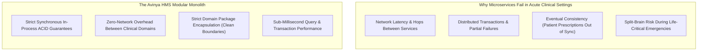

# Chapter 1: Project Overview & Conceptual Foundation
## The What, Why, and Core Philosophy of Avinya HMS

---

## 1. Executive Summary: What is Avinya HMS?

**Avinya HMS** is an industrial-strength, multi-tenant digital healthcare operating platform designed to power the complete clinical, surgical, diagnostic, administrative, and financial lifecycle of modern hospital networks, multi-specialty healthcare systems, and corporate hospital chains.

At its core, a hospital is a high-stakes, 24/7/365 environment where software failures or latency do not simply cause lost revenue—they can lead to severe patient harm or loss of life. Avinya HMS was designed specifically to bridge the vast gap between fragile legacy desktop software and modern, cloud-scale, highly available SaaS platforms without compromising on **absolute data isolation, strict ACID transactions, and clinical patient safety**.

---

## 2. The Problems Avinya HMS Solves

Modern hospitals routinely struggle with three chronic systemic challenges in their software infrastructure:

### Problem 1: Dangerous Clinical Data Fragmentation & Medication Errors
In traditional hospitals, doctors document in one system, nurses log bedside medications in another, and the laboratory processes blood tests in a third disconnected application. This fragmentation leads to devastating medical errors:
- A doctor prescribes a drug that severely interacts with a medication prescribed in a previous encounter.
- A nurse inadvertently administers the wrong medication strength at the bedside because there is no barcode validation.
- A critical laboratory test result (e.g., severe hypokalemia) sits unread in an inbox while the patient deteriorates.

**How Avinya HMS Solves It:**
Avinya HMS unites all 26 hospital domains into a cohesive, synchronized clinical engine with real-time automated safety gates:
- **CPOE Order Sets & NEWS2 Scoring:** Detects physiological deterioration and triggers emergency Rapid Response Teams automatically.
- **Drug-Disease & Cross-Encounter DDI Checks:** Automatically blocks contraindicated medications against the patient's active ICD-10 medical history.
- **Bedside BCMA (Barcode Medication Administration):** Forces positive barcode verification of patient wristband and medication vial before any dose can be logged as administered.
- **Controlled Substances Vault:** Enforces digital dual-witness co-signatures for narcotics dispensation and residual wastage.

### Problem 2: Revenue Leakage & Inpatient Billing Bottlenecks
Hospital billing is notoriously complex. Rooms are occupied at midnight without being charged; surgical consumables used in the Operation Theatre are forgotten; insurance pre-authorizations are mismatched against statutory room rent caps, resulting in claim rejections and revenue loss. Furthermore, patients often spend 6 to 10 hours waiting in the hospital lobby on discharge day while clerks manually audit medication returns and insurance paperwork.

**How Avinya HMS Solves It:**
- **Automated Midnight Census Runner:** Runs automatically at 00:00 every night to post accurate room, bed, and nursing care charges to inpatient ledgers with idempotent deduplication.
- **Multi-Tariff MoU Rate Card Engine:** Automatically resolves insurer-negotiated rates and caps daily room rent according to policy terms.
- **Three-Tier Discharge Clearance Gate:** Inpatients cannot be discharged until Clinical, Pharmacy, and Billing departments provide digital sign-off, ensuring zero lost consumables and zero unbilled charges.

### Problem 3: The Multi-Tenancy Security Dilemma (SaaS vs. Data Isolation)
Hospital networks operate multiple branches or independent hospitals. Traditional SaaS platforms use a single shared database where all tenants share the same tables separated only by a `tenant_id` column. A single developer error in an SQL `WHERE` clause can leak thousands of patient medical records across rival hospital groups—a catastrophic regulatory and legal violation.

**How Avinya HMS Solves It:**
- **Physical Database-per-Tenant Isolation:** Every hospital tenant is provisioned into a physically distinct PostgreSQL database (`hms_apollo`, `hms_manipal`). Horizontal data leakage is physically impossible at the database engine level.
- **Nexus Fleet Control Plane:** Centralizes tenant provisioning, subscription billing, and health monitoring in an independent administrative application (`hms_control_plane`), giving operators the management efficiency of SaaS with the military-grade isolation of dedicated databases.

---

## 3. Core Architectural Philosophy

### 3.1 The Modular Monolith vs. Microservices in Healthcare

A common modern architectural debate is whether to build systems as microservices or monoliths. For a hospital core engine, **Avinya HMS deliberately adopts the Modular Monolith pattern**.

In an emergency department or intensive care unit:
- When a doctor clicks "Order Blood Transfusion", the system must synchronously check donor compatibility, verify blood bank inventory, lock the unit, and update the patient chart within milliseconds.
- If this transaction spanned five independent microservices over HTTP or gRPC, network latency or a single failed container could leave the database in an inconsistent, corrupt state.
- In Avinya HMS, all 26 domains run in a single high-performance FastAPI process backed by PostgreSQL ACID transactions. Complete modularity is maintained through strict package boundaries: domains interact through clean service contracts, never through dirty backdoor SQL joins.

### 3.2 Dual-Application Topology: Hospital Engine vs. Control Plane

Avinya HMS splits responsibilities between two completely independent services:

```mermaid
flowchart LR
    subgraph HOSPITAL_ENGINE["1. Hospital Tenant API (:8000)"]
        direction TB
        H1["Clinical EMR & CPOE"]
        H2["Nursing eMAR & BCMA"]
        H3["Laboratory LIS & MLLP"]
        H4["Pharmacy & Controlled Drugs"]
        H5["Billing, RCM & Invoices"]
        H6["Multi-Tenant DB (hms_{slug})"]
    end

    subgraph CONTROL_PLANE["2. Nexus Fleet Control Plane (:8080)"]
        direction TB
        C1["Hospital Tenant Registry"]
        C2["Zero-Touch Provisioning"]
        C3["Stripe Subscription Billing"]
        C4["Sandbox Data Sanitizer"]
        C5["S3 DR Backups & Restore Drills"]
        C6["Control DB (hms_control_plane)"]
    end

    HOSPITAL_ENGINE <-->|Autonomous Separation| CONTROL_PLANE
```

1. **The Hospital Tenant Engine (`backend/main.py` - Port 8000):**
   - The operational engine used by doctors, nurses, pharmacists, and lab technicians.
   - Routes requests dynamically to the specific hospital tenant database based on the incoming subdomain or host header.
2. **The Nexus Fleet Control Plane (`backend/control_plane/app.py` - Port 8080):**
   - The master administrative engine used by platform operators and hospital group superadmins.
   - Operates against its own independent database (`hms_control_plane`) to provision tenants, manage subscription billing, execute automated schema migrations, clone sanitized sandboxes, and run disaster recovery drills.

---

## 4. Glossary of Terms & Healthcare Acronyms

To help any non-healthcare reader understand the system completely, the following reference table defines all core concepts and acronyms:

| Acronym / Term | Full Name | Meaning & Role in Avinya HMS |
| :--- | :--- | :--- |
| **ADT** | Admission, Discharge, Transfer | The foundational hospital administrative lifecycle governing inpatient bed occupancy and ward movement. |
| **BCMA** | Barcode Medication Administration | Bedside safety protocol verifying the 5-Rights (Patient, Drug, Dose, Route, Time) using optical barcode scanners. |
| **CPOE** | Computerized Physician Order Entry | Electronic ordering system allowing doctors to instantiate standardized clinical care protocols and order sets. |
| **NEWS2** | National Early Warning Score 2 | Standardized clinical scoring system used worldwide to detect physiological deterioration and trigger emergency rapid response. |
| **DDI** | Drug-Drug Interaction | Cross-encounter clinical safety check alerting doctors to adverse physiological interactions between prescribed medicines. |
| **LIS** | Laboratory Information System | Subsystem managing pathology test catalogs (LOINC/CPT), specimen collection, automated analyzer results, and panic alerts. |
| **RIS / PACS** | Radiology Info System / Picture Archiving & Communication System | Modality order management and DICOM medical imaging viewer integration for CT scans, MRIs, and X-rays. |
| **FEFO** | First-Expiry, First-Out | Inventory algorithm dispensing medication batches with the closest expiration date first to eliminate expired drug stock. |
| **CDM** | Charge Description Master | Master catalog defining standard hospital services, procedure fees, room charges, and tariff schedules. |
| **RCM** | Revenue Cycle Management | Financial lifecycle managing charge capture, multi-tariff insurer pricing, invoice generation, and insurance claims. |
| **TPA** | Third-Party Administrator | An organization that processes insurance claims and pre-authorizations on behalf of health insurance companies. |
| **ABDM** | Ayushman Bharat Digital Mission | Government of India national digital health initiative covering ABHA IDs (M1), Consent (M2), and FHIR records (M3). |
| **NHCX** | National Health Claims Exchange | National gateway enabling standardized electronic claim submission and real-time adjudication between hospitals and insurers. |
| **MLLP** | Minimal Lower Layer Protocol | Standard TCP socket framing protocol used by hospital medical devices and analyzers to send HL7 v2 messages. |
| **NABH / JCI** | National Accreditation Board for Hospitals / Joint Commission International | Premier statutory quality accreditation bodies that establish hospital safety standards and quality indicators. |
| **DPDP Act** | Digital Personal Data Protection Act 2023 | India's comprehensive data privacy law governing purpose-specific patient consent, data subject rights, and breach logging. |
| **Envelope Encryption** | Key Encryption Key (KEK) + Data Encryption Key (DEK) | Advanced cryptographic pattern using AES-256-GCM to protect sensitive patient demographics at the column level. |
| **SOAP Notes** | Subjective, Objective, Assessment, Plan | Standardized four-part clinical documentation method used by physicians during consultations and inpatient rounds. |
| **WHO Checklist** | World Health Organization Surgical Safety Checklist | Mandatory surgical safety gate (Sign-In, Time-Out, Sign-Out) preventing wrong-site surgery and surgical complications. |

---

*Proceed to [Chapter 2: System Architecture & Core Topology](02_ARCHITECTURE_AND_SYSTEM_DESIGN.md) to explore the technical topology and infrastructure design.*
