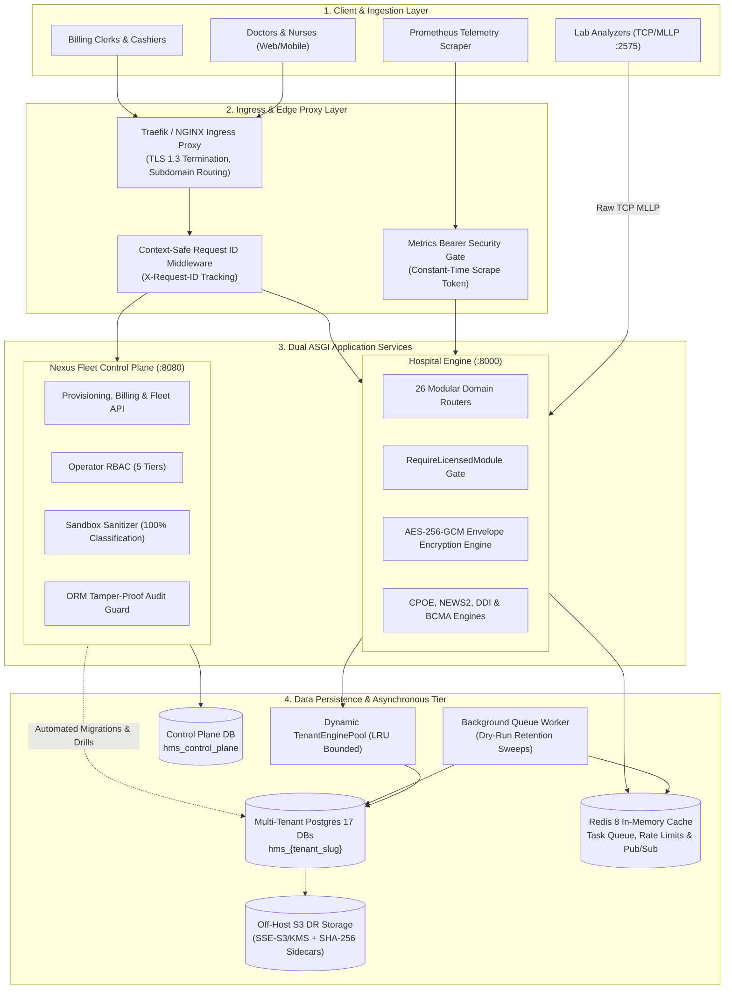

# Chapter 2: System Architecture & Core Topology
## Deep Technical Dive into Infrastructure, Ingress, Database Pooling & Worker Queues

---

## 1. High-Level System Topology

Avinya HMS is architectured as a multi-tier, cloud-native system designed for high concurrency, zero-data-loss resilience, and sub-second transaction latency.



---

## 2. Ingress, Middleware & The Request Lifecycle

Every HTTP request entering Avinya HMS passes through a deterministic sequence of middleware layers:

```
Incoming HTTP Request
  │
  ▼
[Stage 1: Ingress Routing & Subdomain Resolution]
  ├─ Evaluates Host Header (e.g., apollo-delhi.avinyahms.com)
  ├─ Resolves tenant slug: apollo-delhi
  └─ In local development, accepts X-Tenant-Slug header override
  │
  ▼
[Stage 2: Context-Safe Request ID Middleware]
  ├─ Extracts client X-Request-ID or generates UUID v4
  ├─ Injects into Python contextvars.ContextVar
  └─ Sets execution timer (X-Process-Time-Ms)
  │
  ▼
[Stage 3: CORS & Security Header Hardening]
  ├─ Evaluates origins against configured allowed regex list
  ├─ Injects strict security headers: X-Content-Type-Options: nosniff,
  │  X-Frame-Options: DENY, Strict-Transport-Security
  └─ Enforces constant-time bearer token check on /metrics
  │
  ▼
[Stage 4: Dynamic Tenant Database Binding]
  ├─ TenantEnginePool resolves PostgreSQL connection for hms_{tenant_slug}
  ├─ Opens scoped SQLAlchemy session and binds to request.state.db
  └─ Sets search_path and transaction isolation level (Read Committed)
  │
  ▼
[Stage 5: Authentication & License Entitlement Check]
  ├─ Validates JWT bearer token (Argon2id / RSA signed)
  ├─ Evaluates user role and fine-grained permissions
  └─ Evaluates RequireLicensedModule: rejects unpurchased modules with 403
  │
  ▼
[Stage 6: Domain Execution & ACID Transaction]
  ├─ Synchronous business execution (CPOE, BCMA, Invoicing, etc.)
  ├─ Automatic AES-256-GCM column decryption on reads, encryption on writes
  └─ ORM listeners automatically record created_by_id and updated_by_id
  │
  ▼
[Stage 7: Response Injection & Exception Sanitization]
  ├─ Maps database constraint errors to 409 Conflict / 400 Bad Request
  ├─ Sanitizes unhandled exceptions (zero stack traces leaked to client)
  └─ Injects X-Request-ID and X-Process-Time-Ms into outgoing response
```

---

## 3. Database Architecture & Multi-Tenant Pooling

### 3.1 Physical Database-per-Tenant Isolation

Rather than sharing tables with a `tenant_id` column, Avinya HMS provisions an **independent, isolated PostgreSQL database for every hospital tenant**.
- **Naming Convention:** `hms_{tenant_slug}` (e.g., `hms_apollo_hyd`, `hms_fortis_delhi`).
- **Physical Boundary:** Tables in `hms_apollo_hyd` cannot join or query tables in `hms_fortis_delhi`. This provides physical assurance against cross-tenant data leakage.
- **Independent Life-Cycles:** Individual hospital databases can be independently backed up, restored to point-in-time (PITR), cloned into testing sandboxes, or archived without touching other tenants.

### 3.2 Dynamic Tenant Engine Pooling (`TenantEnginePool`)

Creating hundreds of database engines in memory would exhaust server file descriptors and database connection limits. Avinya HMS manages database connectivity via a **bounded, LRU-cached dynamic engine pool** (`backend/core/database.py`):

```python
class TenantEnginePool:
    """Manages dynamic, bounded SQLAlchemy connection pools per tenant."""
    def get_engine(self, tenant_slug: str) -> Engine:
        # 1. Check if engine is cached in memory
        # 2. If missing, construct connection URL: postgresql+psycopg2://.../hms_{tenant_slug}
        # 3. Configure Pool Size (default: 5 connections, max overflow: 10)
        # 4. Enforce pool recycling (prevents stale connections across firewalls)
        # 5. Evict oldest idle engines if LRU bound is exceeded
```

### 3.3 Atomic High-Concurrency Row Locking (`FOR UPDATE NOWAIT`)

In hospital operations, high-concurrency collisions are frequent (e.g., two admission clerks attempting to allocate Bed 402 simultaneously, or two ward nurses dispensing the last vial of an antibiotic).

Avinya HMS uses **pessimistic non-blocking database row locks**:
```python
stmt = select(Bed).where(Bed.id == bed_id).with_for_update(nowait=True)
result = session.execute(stmt).scalar_one_or_none()
```
- **The Behavior:** The first transaction acquires an exclusive lock on that row. If a second transaction attempts to access the same bed within that millisecond, PostgreSQL immediately raises an operational exception rather than hanging or deadlocking.
- **The Result:** The system responds immediately with `HTTP 409 Conflict` ("Resource locked by another transaction, please retry"), guaranteeing zero double-allocations and zero hanging connections.

---

## 4. Asynchronous Queue Architecture & Worker Daemon

Not all hospital tasks should run synchronously in the API request loop. Heavy operations—such as statutory data retention sweeps, nightly batch invoicing, bulk SMS notifications, and SIEM audit exports—are processed by a **dedicated asynchronous background worker daemon** (`backend/worker.py`).

```mermaid
sequenceDiagram
    autonumber
    participant API as FastAPI Hospital Engine
    participant Redis as Redis 8 Task Broker
    participant Worker as Background Worker Daemon
    participant DB as Tenant Database (Postgres 17)

    API->>Redis: LPUSH task payload (JSON serialized, signed)
    Note over API,Redis: No Python pickle used; safe JSON schemas only
    Worker->>Redis: BRPOP task queue (blocking pop)
    Redis-->>Worker: Deliver task payload
    Worker->>Worker: Validate job signature & safety constraints
    
    alt Task is Scheduled Data Retention Sweep
        Note over Worker: Worker hardcodes dry_run=True for automated runs
        Worker->>DB: Scan records past retention threshold
        DB-->>Worker: Return eligible count (zero destructive deletions)
    else Task is Batch Invoicing
        Worker->>DB: Process charges and generate invoice PDFs
    end
    
    Worker->>Redis: HDEL payload & store result with 1-hour TTL
    Note over Redis: Sensitive payloads scrubbed from memory
```

### Safety & Hygiene Safeguards in the Queue:
1. **Named Handlers over JSON:** No Python `pickle` deserialization is allowed. Tasks must match explicitly registered named string handlers (`privacy.retention.execute`, `billing.census.run`), preventing arbitrary remote code execution (RCE).
2. **Forced Dry-Run Retention Sweeps:** Scheduled periodic retention sweeps executed by the worker are hardcoded to `dry_run=True`. Destructive erasures cannot be executed autonomously by background jobs.
3. **Payload Sanitization & 1-Hour TTL:** Task arguments often contain patient IDs or clinical metadata. As soon as a job completes, its raw input payload is deleted from Redis memory (`HDEL`), and its result status is assigned a strict 1-hour expiration time-to-live (`TTL`).

---

## 5. Native HL7 v2 MLLP Socket Interface Engine

Tertiary hospitals operate hundreds of physical biomedical analyzers (biochemistry, hematology, blood gas). These machines communicate using **HL7 v2.x over raw TCP sockets wrapped in Minimal Lower Layer Protocol (MLLP) framing**.

Avinya HMS features a built-in asynchronous MLLP server (`backend/domains/integrations/listener.py` running on port 2575):

```
MLLP Framing Format:
  [Start Block: \x0b] ──> [HL7 v2 Text Message] ──> [End Block: \x1c\x0d]
```

### Message Lifecycle on Port 2575:
1. **Socket Ingestion:** An automated analyzer (e.g., Roche Cobas) establishes a persistent TCP connection and sends an unsolicited observation result (`ORU^R01`).
2. **Frame Extraction:** The listener validates the starting vertical tab (`\x0b`) and ending field separator/carriage return (`\x1c\x0d`), rejecting malformed frames.
3. **Observation Parsing:** The parser extracts:
   - `MSH` (Message Header): Sending machine identifier and message control ID.
   - `PID` (Patient Identification): Patient MRN or accession number.
   - `OBR` (Observation Request): Diagnostic panel order code.
   - `OBX` (Observation Result): Analyte mnemonic (e.g., `GLUC`, `K+`), numeric value, units, reference range, and abnormal flags (`L`, `H`, `LL`, `HH`).
4. **Immediate Acknowledgment (ACK):** The listener generates and returns an HL7 `MSA` Acknowledgment message to the machine within 50 milliseconds so the analyzer clears its transmission queue.
5. **Equipment Test Mapping & Delta Checking:** The extracted test code is resolved against internal hospital catalogs, delta checks are calculated against historic baselines, and results are filed directly into the patient's electronic health record.

---

## 6. Telemetry & Observability Architecture

### 6.1 Prometheus Metrics Scrape Endpoint (`/metrics`)
Avinya HMS exports real-time system and business telemetry formatted for Prometheus:
- **Security Gate:** To prevent reconnaissance of hospital operational volume, `/metrics` is protected by a constant-time bearer token check (`METRICS_SCRAPE_TOKEN`). Unauthenticated requests receive `401 Unauthorized`.
- **Key Metrics Tracked:**
  - `http_requests_total`: Request volume partitioned by method, endpoint, and HTTP status code.
  - `http_request_duration_seconds`: High-resolution latency histograms (p50, p95, p99).
  - `tenant_engine_pool_active_connections`: Current active database connections across all hospital tenants.
  - `redis_queue_depth`: Number of pending jobs waiting in background worker queues.
  - `clinical_safety_alerts_total`: Frequency of DDI hard stops, NEWS2 high-risk alerts, and BCMA barcode mismatch blocks.

### 6.2 Context-Correlated Structured JSON Logging
Every log entry emitted by the backend is structured JSON containing:
- `timestamp`: ISO-8601 UTC timestamp.
- `level`: `INFO`, `WARNING`, `ERROR`, `CRITICAL`.
- `request_id`: The correlated `X-Request-ID` UUID.
- `tenant_slug`: The tenant database being operated on.
- `module`: The originating domain package (e.g., `clinical.cpoe`, `pharmacy.bcma`).
- `message`: Human-readable summary accompanied by contextual metadata.

---

*Proceed to [Chapter 3: End-to-End Clinical & Business Workflows](03_END_TO_END_CLINICAL_AND_BUSINESS_WORKFLOWS.md) to explore the clinical journey from registration to discharge.*
