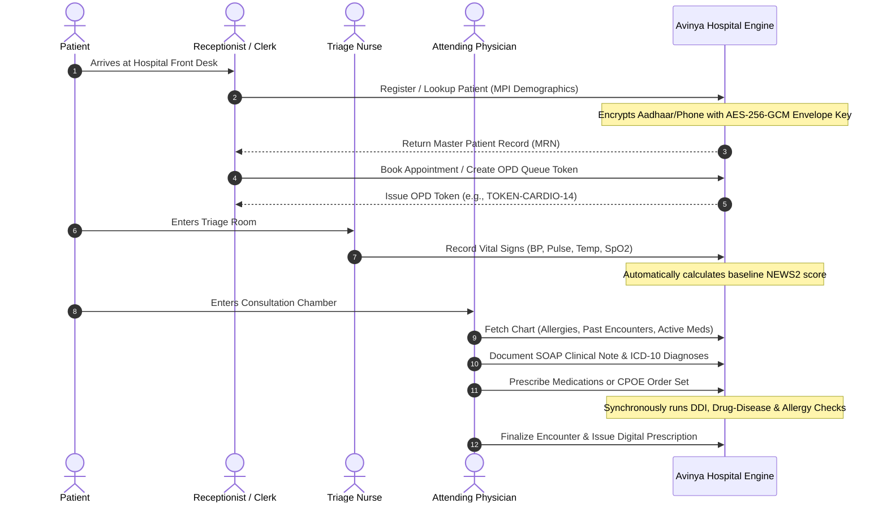
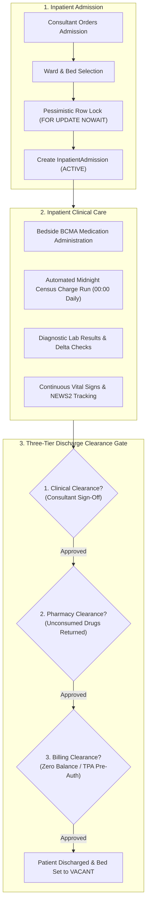
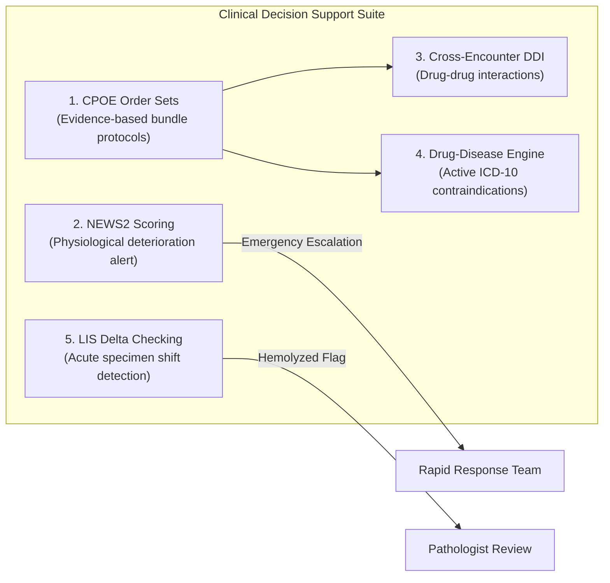
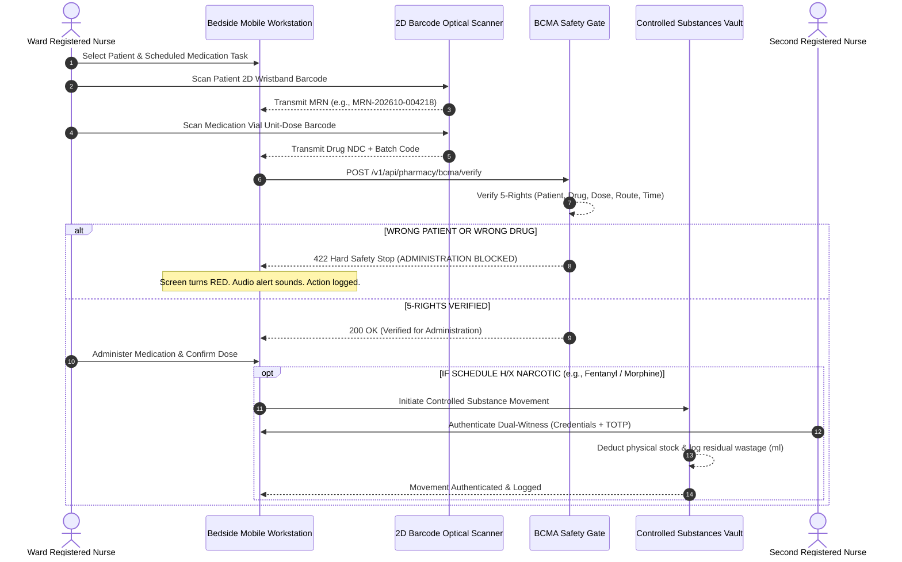
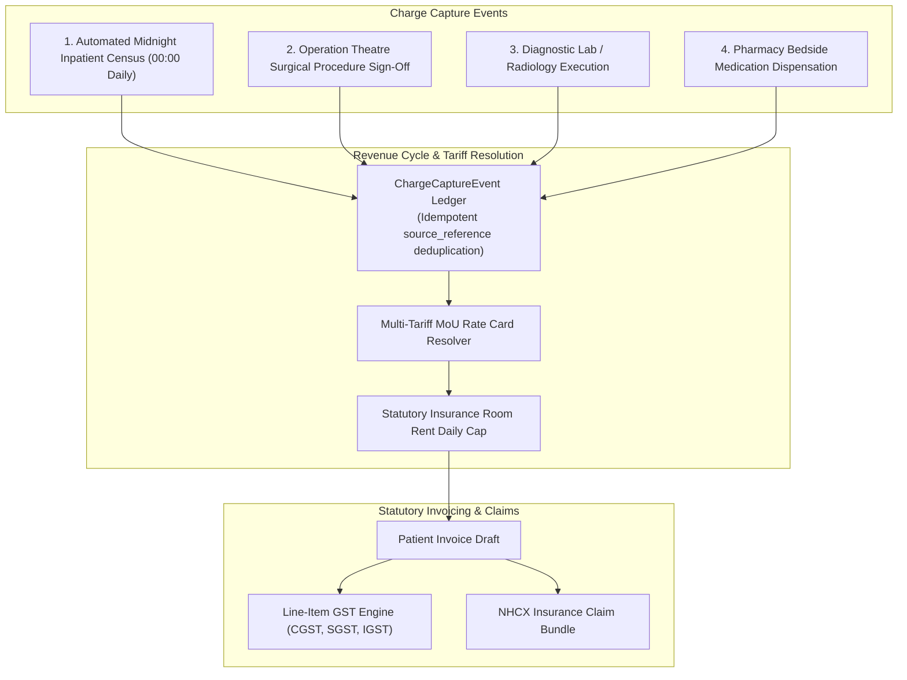
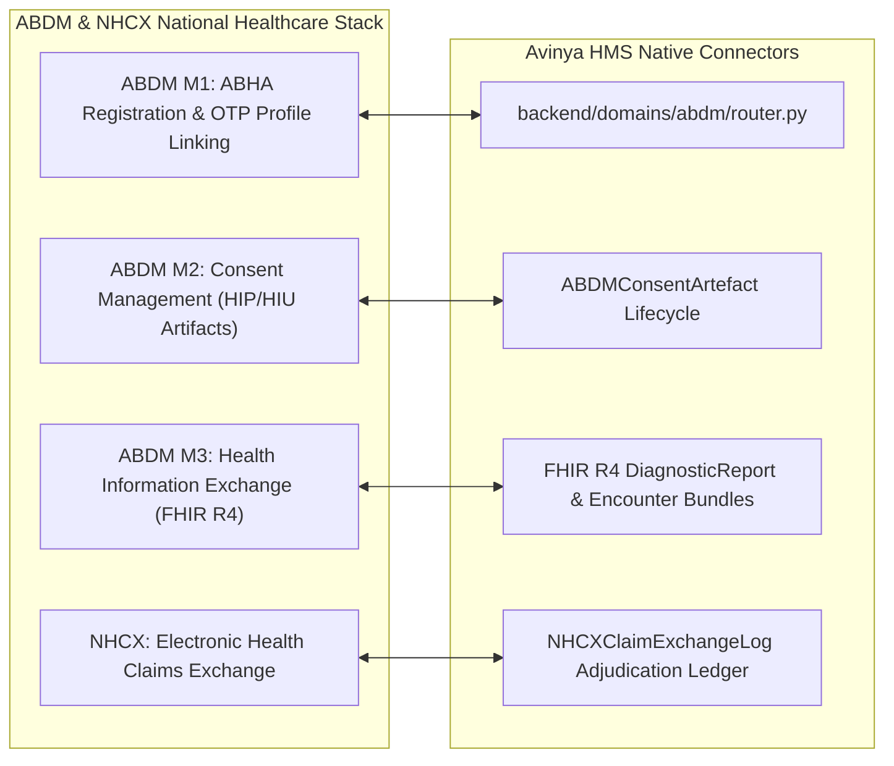

# Chapter 3: End-to-End Clinical & Business Workflows
## A Comprehensive Operational Guide to All 26 Hospital Domains & Patient Safety Gates

---

## 1. The Patient Lifecycle: Outpatient (OPD) Consultation Journey

The Outpatient Department (OPD) manages the arrival, triage, consultation, and treatment of non-admitted ambulatory patients.



### Detailed Workflow Stages:
1. **Patient Registration & MPI Lookup:**
   - If a patient is new, the clerk enters their demographic data. The system generates an immutable Medical Record Number (`MRN-YYYYMM-XXXXXX`).
   - Sensitive identifiers (Aadhaar number, mobile number, postal address) are encrypted at the column level using **AES-256-GCM**.
   - If the patient has visited other hospitals in a corporate group, an audited cross-tenant MPI lookup (`/mpi/lookup`) can resolve the pointer record with mandatory justification.
2. **Triage & Vital Signs:**
   - The triage nurse records blood pressure, pulse rate, respiratory rate, and oxygen saturation.
   - The system immediately evaluates these vitals against **NEWS2 early warning thresholds**. If the vitals indicate high clinical risk, an immediate alert is displayed.
3. **Doctor Consultation & SOAP Documentation:**
   - The physician documents findings in structured **SOAP notes**:
     - *Subjective:* Chief complaints, patient history of present illness.
     - *Objective:* Physical examination findings, current vital signs.
     - *Assessment:* ICD-10 coded clinical diagnoses (e.g., `I10` Essential Hypertension, `E11` Type 2 Diabetes).
     - *Plan:* Prescriptions, diagnostic orders, and follow-up advice.
4. **Prescription Safety Checks:**
   - The moment the doctor adds a medication, the **Drug-Drug Interaction (DDI)** and **Drug-Disease Contraindication** engines execute synchronously before the order can be signed.

---

## 2. Inpatient (IPD / ADT) Admission Lifecycle

Inpatient care governs the admission, accommodation, nursing, and discharge of hospitalized patients.



### High-Concurrency Bed Reservation:
When an admission clerk selects a bed, the database executes:
```sql
SELECT * FROM beds WHERE id = :bed_id FOR UPDATE NOWAIT;
```
If two clerks attempt to reserve the same bed at the exact same instant, the second request immediately fails with an operational conflict rather than waiting or allowing a double-booking. The bed transitions from `VACANT` to `OCCUPIED`.

### The Three-Tier Discharge Clearance Gate:
To eliminate revenue leakage and medical negligence during discharge, Avinya HMS enforces a strict **three-key cryptographic gate**:
1. **Key 1: Clinical Sign-Off:** The attending consultant must author a finalized discharge summary, post-discharge instructions, and follow-up medication prescriptions.
2. **Key 2: Pharmacy Clearance:** The ward pharmacy must inspect the patient's bedside drug stock. All unconsumed medication ampoules or tablets must be physically returned and credited to the invoice.
3. **Key 3: Billing Clearance:** The cashier reconciles all midnight census charges, lab fees, and surgical consumables against insurance pre-authorization limits. The patient must clear any remaining copay.
*Until all three clearance flags are set to `TRUE`, the API strictly refuses to discharge the patient or release the bed.*

---

## 3. Clinical Decision Support (CDS) & Patient Safety Suite

Avinya HMS features an integrated suite of clinical safety systems designed to prevent medical errors before they reach the patient:



### 3.1 CPOE Standardized Protocol Order Sets (`OrderSet`)
In tertiary hospitals, complex acute conditions (e.g., Sepsis, Acute Myocardial Infarction, Stroke) require rapid, synchronized interventions. Avinya HMS supports **Computerized Physician Order Entry (CPOE) Order Sets**:
- Rather than typing twelve individual orders, the doctor selects an approved protocol (e.g., `"SEPSIS_BUNDLE"`).
- The order set atomically generates:
  - *Diagnostic Orders:* Blood Cultures x2, Serum Lactate stat, Complete Blood Count, Arterial Blood Gas.
  - *Medications:* IV Broad-Spectrum Antibiotics stat, Normal Saline 30ml/kg bolus.
  - *Nursing Directives:* Insert Foley Catheter, hourly urine output monitoring, continuous pulse oximetry.
- All items execute in a single atomic database transaction.

### 3.2 NEWS2 Physiological Deterioration Early Warning Scoring
The platform evaluates vital signs using the **National Early Warning Score 2 (NEWS2)** protocol:
- **Parameters Scored (0 to 3 each):** Respiration rate, Oxygen saturation (SpO2), Supplemental oxygen dependency, Systolic blood pressure, Heart rate, Consciousness level (AVPU scale), and Temperature.
- **Automated Escalation Triggers:**
  - *Total Score 0–4 (Low Risk):* Routine ward observations every 4 to 6 hours.
  - *Total Score 5–6 or individual parameter score of 3 (Medium Risk):* Urgent review by ward nurse and resident medical officer within 30 minutes; increase vital monitoring frequency to every hour.
  - *Total Score >= 7 (High Clinical Risk):* **Emergency Alarm.** Automatically alerts the hospital Rapid Response Team (RRT) or Intensive Care Consultant for immediate bedside evaluation and potential ICU transfer.

### 3.3 Drug-Disease Contraindication Engine
Avinya HMS cross-references prescribed active generic molecules against the patient's active ICD-10 diagnoses:
- **Beta-blockers (e.g., Propranolol, Atenolol):** Hard stop in patients with active Bronchial Asthma (`J45`) due to bronchospasm risk.
- **NSAIDs (e.g., Ibuprofen, Diclofenac):** Major warning/hard stop in patients with active Peptic Ulcer Disease (`K27`) or Severe Renal Failure (`N18.5`).
- **Metformin:** Hard stop in patients with acute lactic acidosis or advanced chronic kidney disease.

### 3.4 Cross-Encounter Drug-Drug Interaction (DDI) Engine
The DDI engine checks for potential interactions not just within the current prescription, but across **all active medications from all recent hospital visits and inpatient stays**.
- **Severity Levels:**
  - `CRITICAL_HARD_STOP`: Absolute contraindication (e.g., Sildenafil + Nitrates). The system physically refuses to sign the prescription.
  - `MAJOR_WARNING`: Serious potential toxicity. Requires explicit physician clinical override with a mandatory documented justification string (minimum 15 characters).
  - `MODERATE_INFO`: Cautionary advice displayed for clinical awareness.

---

## 4. Bedside Medication Administration (BCMA) & Controlled Substances Vault



### 4.1 BCMA 5-Rights Bedside Verification
To prevent medication administration errors, Avinya HMS implements optical **Barcode Medication Administration (BCMA)**:
1. **Right Patient:** Verifies scanned wristband barcode matches the inpatient encounter.
2. **Right Drug:** Verifies scanned medication barcode resolves to the physician's prescribed order.
3. **Right Dose:** Verifies scanned unit strength matches the prescribed dosage.
4. **Right Route:** Verifies formulation (e.g., IV injection vs oral tablet) matches prescribed route.
5. **Right Time:** Verifies administration occurs within the authorized clinical window (e.g., scheduled time ±60 minutes).
- **Strict Hard Stops:** A mismatch in Patient or Drug triggers an immediate, un-bypassable hard stop (`422 Unprocessable Entity`), locking the screen and alerting the ward supervisor.

### 4.2 Schedule H/X Controlled Substances Perpetual Vault
In strict compliance with statutory narcotics regulations (NDPS Act), high-risk controlled substances (Morphine, Fentanyl, Pethidine, Ketamine, Midazolam) are tracked in an immutable digital perpetual vault:
- **Perpetual Balance Tracking:** Every ampoule received or dispensed updates the physical balance in real-time.
- **Dual-Witness Digital Co-Signature:** Administering a narcotic requires two independent licensed nurses to authenticate at the workstation with credentials and TOTP.
- **Wastage Forensics:** When a partial dose is administered (e.g., 2ml given from a 5ml ampoule), the remaining 3ml must be physically discarded and witnessed. The system records the administered volume, wasted volume, administering nurse ID, and witness nurse ID into an unalterable audit log.

---

## 5. Diagnostic Laboratory (LIS), Native HL7 v2 MLLP & Delta Checking

```mermaid
flowchart LR
    subgraph CLINICAL_ORDER["1. Diagnostic Ordering"]
        DOCTOR["Physician Orders Lab Panel"]
        LIS_ORDER["DiagnosticOrder Created (LOINC/CPT)"]
        BARCODE["Specimen Tube Barcode Printed"]
    end

    subgraph AUTOMATED_ANALYZER["2. Analyzer Execution (:2575)"]
        ROCHE["Roche Cobas Analyzer"]
        MLLP_SOCK["TCP/MLLP Socket Listener"]
        ORU_PARSE["Unsolicited ORU^R01 Message Parser"]
    end

    subgraph SAFETY_AND_FILING["3. Safety Verification & Filing"]
        TEST_MAP["Equipment Test Mapping Engine"]
        DELTA_EVAL["Automated Numeric Delta Check"]
        PANIC_ALERT["Critical Panic Value Alert (LL/HH)"]
        PATH_SIGN["Senior Pathologist Digital Sign-Off"]
    end

    DOCTOR --> LIS_ORDER --> BARCODE
    BARCODE --> ROCHE
    ROCHE -->|TCP MLLP \x0b...\x1c\x0d| MLLP_SOCK --> ORU_PARSE
    ORU_PARSE --> TEST_MAP --> DELTA_EVAL
    DELTA_EVAL -->|Acute Delta Shift| PANIC_ALERT
    DELTA_EVAL --> PATH_SIGN
```



### 5.1 Native HL7 v2 MLLP Analyzer Interface
Avinya HMS features a built-in TCP socket listener running on **port 2575**. Automated clinical chemistry and hematology analyzers connect directly to this port:
- Analyzers transmit unsolicited `ORU^R01` observation messages formatted with standard MLLP framing (`\x0b` start block, `\x1c\x0d` end block).
- The system parses the message in memory, extracts the analyzer mnemonic (e.g., `K+` for Potassium, `GLUC` for Blood Glucose), maps it via `EquipmentTestMapping` to internal catalog codes, and returns an immediate HL7 `MSA` ACK handshake.

### 5.2 Historic Laboratory Delta Checking
Before any numeric lab result is presented to clinicians, the **LIS Delta Checking Engine** executes an automatic retrospective check:
- It fetches the patient's immediate previous valid result for that same analyte within a configurable window (e.g., 48 hours).
- **The Evaluation:** If a patient's Potassium jumps from 3.8 mEq/L to 6.8 mEq/L in 4 hours, this represents an acute, physiologically improbable delta.
- **Clinical Significance:** An acute shift often indicates a pre-analytical error—such as sample hemolyzation or blood drawn upstream of an active IV infusion. The system automatically flags the result with `DELTA_CHECK_VIOLATION` and holds it for pathologist verification, preventing false clinical interventions.

### 5.3 Critical Panic Value Alerting
Results breaching life-threatening thresholds (`LL`, `HH`, `PANIC`) trigger immediate automated WebSocket alert broadcasts to ward nursing stations and attending physicians.

---

## 6. Revenue Cycle Management (RCM), CDM & Billing Automation



### 6.1 Multi-Tariff MoU Rate Card Resolution Engine
Hospitals maintain multiple pricing schedules:
- **Cash / Self-Pay:** Standard hospital base Chargemaster (CDM) rates.
- **Corporate MoUs:** Discounted corporate partner rates.
- **TPA / Health Insurance:** Contractually negotiated tariff rate cards (`InsurancePlanTariff`).
The `resolve_service_tariff` engine evaluates the patient's active policy, applies negotiated service rates, and enforces **contractual daily room rent caps** (e.g., insurance covers max ₹5,000/day for private rooms; any excess room charge is automatically apportioned to the patient's copay ledger).

### 6.2 Automated Midnight Inpatient Census Run
At 00:00 every night, an automated background runner queries all active `InpatientAdmission` records and captures:
- Inpatient Room and Bed Occupancy Fees
- Daily Resident Medical Officer (RMO) Rounds
- Routine Ward Nursing Care Charges
Every charge event is tagged with an idempotent `source_reference` (e.g., `CENSUS-ADM412-BED10-20261026`), guaranteeing that if the job retries, duplicate charges are physically impossible.

### 6.3 Statutory GST Invoicing & AR Aging
- **Statutory GST Breakdown:** Compliant with Indian taxation laws, computing Central GST (CGST) and State GST (SGST) for intra-state care, or Integrated GST (IGST) for inter-state patients.
- **Accounts Receivable (AR) Aging:** Automatically aggregates outstanding patient balances into aging buckets: `0-30 Days`, `31-60 Days`, `61-90 Days`, and `90+ Days` (delinquent), incorporating tax liabilities into revenue forecasting.

---

## 7. Regulatory Gateways: ABDM (M1-M3) & NHCX

Avinya HMS connects natively to India's **Ayushman Bharat Digital Mission (ABDM)** and **National Health Claims Exchange (NHCX)**:



1. **ABDM M1 (ABHA Profile):** Generates and verifies 14-digit Ayushman Bharat Health Accounts (ABHA) and `@abdm` addresses via mobile demographic OTP.
2. **ABDM M2 (Consent Management):** Receives and processes digital consent requests from other hospitals (HIU) or patients, validating cryptographic signatures before authorizing record release.
3. **ABDM M3 (FHIR R4 Bundles):** Packages clinical encounters, discharge summaries, laboratory reports, and diagnostic observations into internationally compliant **FHIR R4 JSON Bundles** for seamless inter-hospital data exchange.
4. **NHCX Gateway:** Dispatches standardized electronic claim bundles to insurers and logs real-time adjudication callbacks directly into hospital financial ledgers.

---

## 8. Hospital Quality Accreditations (NABH / JCI) & Adverse Incident CAPA

Accreditation bodies (NABH 5th Edition and JCI 7th Edition) require hospitals to measure and improve clinical outcomes continuously. Avinya HMS calculates these indicators dynamically:

### Key Hospital Quality Benchmarks Computed:
- **CAUTI Rate:** Catheter-Associated Urinary Tract Infections per 1,000 urinary catheter device days.
- **CLABSI Rate:** Central Line-Associated Bloodstream Infections per 1,000 central venous catheter days.
- **VAP Rate:** Ventilator-Associated Pneumonia cases per 1,000 mechanical ventilator days.
- **Surgical Site Infection (SSI) Rate:** Post-operative surgical site infections per 100 major surgical procedures.
- **Inpatient Fall Rate:** Patient fall incidents per 1,000 occupied bed days.
- **Medication Error Rate:** Bedside BCMA errors and adverse drug reactions per 1,000 administered doses.

### Adverse Incident Register & CAPA Workflow:
When an adverse event occurs (`NEAR_MISS`, `MINOR`, `MODERATE`, `MAJOR`, `SENTINEL`), quality officers follow a structured lifecycle:
`REPORTED` ➔ `UNDER_REVIEW` ➔ `CAPA_ASSIGNED` ➔ `RESOLVED` ➔ `CLOSED`
Major and sentinel events mandate documented **Root Cause Analysis (RCA)** (e.g., 5-Whys methodology) and a binding **Corrective and Preventive Action (CAPA)** plan with quality committee sign-off.

---

## 9. Operational Support Services: BMW, Blood Bank, Surgery, Workforce & AP

- **Biomedical Waste (BMW) Tracking:** Manages hazardous biomedical waste using statutory color-coded categorization (Yellow, Red, White, Blue). Every waste bag is barcoded, weighed at ward collection, and reconciled against authorized Common Bio-medical Waste Treatment Facility (CBWTF) pickup manifests.
- **Blood Bank & Transfusion Safety:** Tracks voluntary blood donors, mandatory viral serology screening (HIV, Hepatitis B, Hepatitis C, Syphilis, Malaria), blood component separation (PRBC, Platelets, FFP), and recipient cross-matching compatibility testing.
- **Operation Theatre (OT) & WHO Checklists:** OT scheduling, surgical team rostering, Pre-Anesthetic Checkup (PAC) clearance gates, and digital enforcement of the **World Health Organization (WHO) Surgical Safety Checklist** (Sign-In before induction, Time-Out before skin incision, Sign-Out before wound closure).
- **Workforce & Statutory Payroll:** Staff biometric attendance tracking, leave balances, and statutory deductions (Employee Provident Fund, Employee State Insurance, Professional Tax, TDS) with locked pay periods preventing retroactive tampering.
- **Accounts Payable & 3-Way Matching:** Purchase Orders (PO), Goods Receipt Notes (GRN), and Vendor Invoices reconciled via automated 3-way matching before payment voucher release.

---

*Proceed to [Chapter 4: Operator & Administrator Manual](04_OPERATOR_AND_ADMINISTRATOR_MANUAL.md) to learn how to administer the multi-tenant control plane, provision tenants, and manage backups.*
