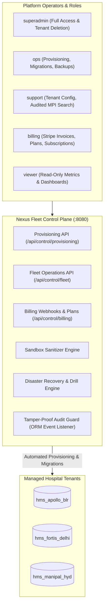
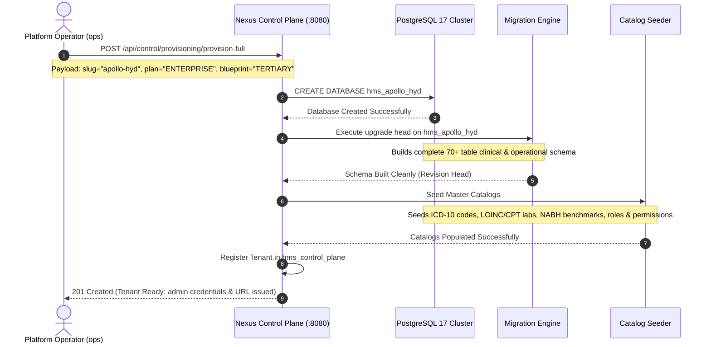
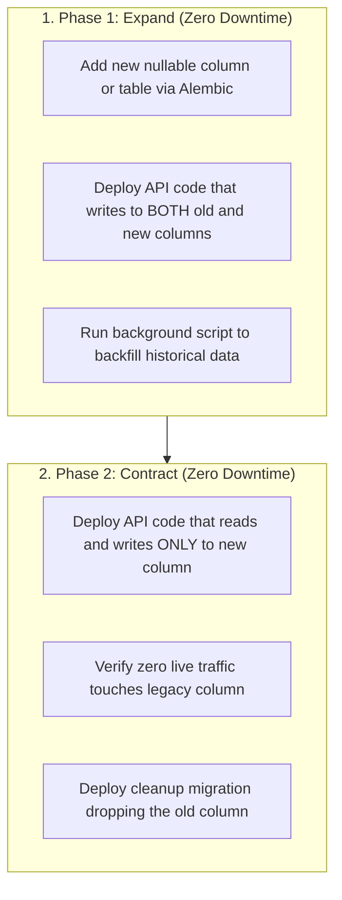
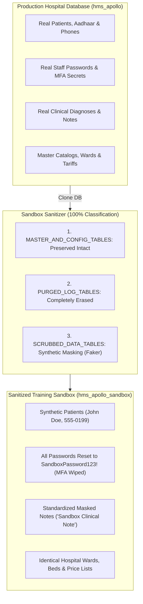
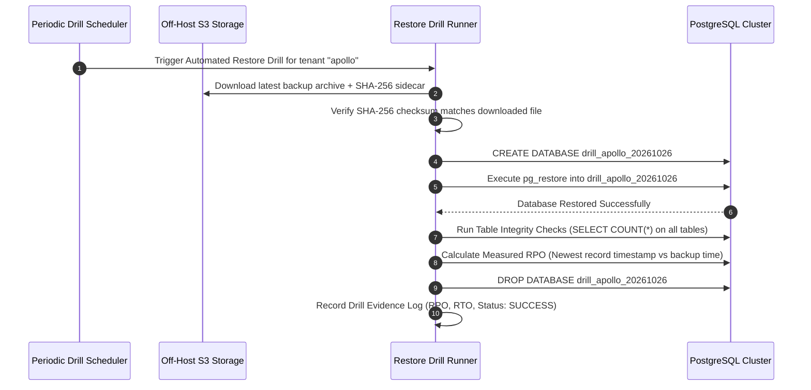

# Chapter 4: Operator & Administrator Manual
## Managing the Multi-Tenant Fleet, Tenant Provisioning, Migrations & Disaster Recovery

---

## 1. Introduction to Nexus SaaS Control Plane

The **Nexus SaaS Control Plane** (`backend/control_plane/app.py`, running on port 8080) is the administrative cockpit for Avinya HMS. While doctors and nurses interact with the Hospital Tenant Engine on port 8000, platform operators, hospital group CIOs, and system administrators use the Control Plane to govern the entire hospital fleet.



### Operator RBAC Matrix (5 Access Tiers):
1. **`superadmin`:** Highest privileges. Can create/delete tenants, rotate master encryption keys, override billing freezes, and provision other operators.
2. **`ops`:** Infrastructure and fleet maintenance. Can provision new tenants, trigger database migrations, execute off-host S3 backups, and launch restore drills.
3. **`support`:** Hospital technical support. Can update tenant policy configurations, reset tenant administrator passwords, and perform audited MPI patient lookups with mandatory justification.
4. **`billing`:** Financial administration. Can configure hospital pricing tiers, view Stripe invoice statuses, and manage licensing seat quotas.
5. **`viewer`:** Read-only access to operational dashboards and system telemetry.

---

## 2. Zero-Touch Tenant Provisioning in Under 60 Seconds

When a new hospital signs a contract, an operator can provision a fully functional, isolated hospital instance in under 60 seconds with **zero manual SQL execution**.

### Step-by-Step Provisioning Workflow:



### Provisioning Blueprints:
Operators choose from pre-configured blueprints tailored to facility size:
- **`PRIMARY_CLINIC`:** OPD queues, basic pharmacy, consultation SOAP notes, vital signs.
- **`SECONDARY_HOSPITAL`:** OPD, Inpatient ADT, ward bed management, basic LIS laboratory, GST invoicing.
- **`TERTIARY_MEDICAL_CENTER`:** Complete 26-domain suite including CPOE order sets, NEWS2 scoring, BCMA bedside verification, controlled substances vault, native HL7 v2 MLLP analyzer interface, ABDM M1-M3 gateways, and NABH/JCI quality accreditations.

---

## 3. Multi-Tenant Schema Migrations & Zero-Downtime Releases

Because Avinya HMS isolates tenants into independent databases, running schema updates across 100+ hospital tenants requires automated, reliable orchestration.

### 3.1 Running Migrations Across the Fleet:
To apply new database migrations to all active tenant databases, operators execute:
```bash
python -m backend.scripts.migrate --all-tenants
```
- **The Execution:** The runner queries `hms_control_plane` for all active tenants, iterates through each database in sequence, acquires an exclusive migration lock, runs `alembic upgrade head`, verifies schema integrity, and records the new revision hash.

### 3.2 The Expand-and-Contract Zero-Downtime Pattern:
In a 24/7 hospital, you cannot lock tables or drop columns while surgeons and nurses are actively documenting care. Avinya HMS strictly enforces the **Expand-and-Contract migration pattern**:



---

## 4. Sandbox Sanitizer: 100% Synthetic Masking & Safe Staging

Hospitals frequently require realistic staging and training environments where new doctors, nurses, and billing staff can practice without risking real patient data. However, copying production patient records or real staff credentials into a test environment violates the DPDP Act and HIPAA.

Avinya HMS features an automated **Sandbox Sanitizer** (`backend/control_plane/services/sandbox_sanitizer.py`):



### Table Classification Guarantee:
The sanitizer verifies that **100% of tables in the database** belong to one of three categories:
1. **`MASTER_AND_CONFIG_TABLES` (Preserved Intact):** Master medical catalogs (ICD-10, LOINC/CPT), hospital wards, beds, pricing tariffs, and role permission matrices.
2. **`PURGED_LOG_TABLES` (Completely Wiped):** Security sessions (`auth_sessions`), password reset tokens, MFA TOTP secrets, raw HL7 device logs, and integration audit trails.
3. **`SCRUBBED_DATA_TABLES` (Deterministically Masked):**
   - Patient names replaced with synthetic names (`Faker`).
   - National IDs (Aadhaar) and phone numbers replaced with synthetic tokens.
   - Clinical notes replaced with generic placeholder text (`"Sandbox clinical documentation"`).
   - All user passwords reset to a single standardized development password (`SandboxPassword123!`).
*Result:* Hospital staff can train in an environment that looks, feels, and behaves identically to their real hospital, with zero risk of real patient privacy leakage.

---

## 5. Disaster Recovery, Off-Host S3 Backups & Automated Restore Drills

Healthcare regulations mandate that hospitals maintain robust Business Continuity and Disaster Recovery (BCDR) plans with verified Recovery Point Objectives (RPO) and Recovery Time Objectives (RTO).

### 5.1 Off-Host S3 Delivery & Sidecar Cryptography
- **Automated Backup Runner:** Exports a full, compressed PostgreSQL archive (`pg_dump -Fc`).
- **Cryptographic Checksum:** Generates a SHA-256 sidecar file containing the exact hash of the archive.
- **Off-Host S3 Upload:** The archive and its checksum are uploaded using `boto3` to an off-host Amazon S3 bucket configured with **Object Lock (WORM - Write Once, Read Many)** and **Server-Side Encryption (SSE-KMS)**.
- **Verification Read-Back:** The delivery script immediately reads back the S3 object metadata and verifies the cryptographic ETag before marking the backup as successfully delivered.

### 5.2 Automated Pre-Restore Safety Snapshots
A major operational risk during disaster recovery is a human administrator accidentally restoring an old backup over the wrong database.
- In Avinya HMS, the restore endpoint **automatically forces an immutable pre-restore safety snapshot of the target database** before allowing any restore operation to commence.
- If an operator accidentally restores the wrong file, the target database can be rolled back to its state immediately preceding the restore command.

### 5.3 Automated Restore Drills (`restore_drill.py`)
A backup that has never been restored is merely a hope, not a disaster recovery plan. Avinya HMS features an automated **Disaster Recovery Drill Runner** (`backend/scripts/restore_drill.py`):



- **Safety Constraint:** Drills strictly create ephemeral databases matching `^drill_[a-zA-Z0-9_]+$`. The drill script cannot drop or modify live hospital production databases.
- **Audit Verification:** The drill records the measured RPO (time variance between newest record and backup creation) and RTO (seconds taken to complete restore).

---

## 6. Routine Operational Healthchecks

Platform operators can verify system health at any time:

| Check | Command / Endpoint | Expected Healthy Response |
| :--- | :--- | :--- |
| **Hospital API Health** | `GET http://localhost:8000/health` | `{"status": "ok", "environment": "production"}` |
| **Control Plane Health**| `GET http://localhost:8080/health` | `{"status": "ok", "control_plane": "ready"}` |
| **Database Pool Health** | `GET http://localhost:8080/api/control/fleet/health` | `{"healthy_tenants": N, "unhealthy_tenants": 0}` |
| **Redis Broker Check**  | `redis-cli -a $REDIS_PASSWORD ping` | `PONG` |
| **MLLP Port Status**    | `nc -zv localhost 2575` | `Connection to localhost 2575 port [tcp] succeeded!` |

---

*Proceed to [Chapter 5: Troubleshooting, Error Handling & Runbooks](05_TROUBLESHOOTING_ERROR_HANDLING_AND_RUNBOOKS.md) to learn how to diagnose and resolve production errors.*
