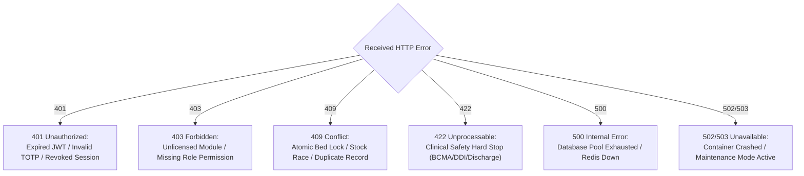
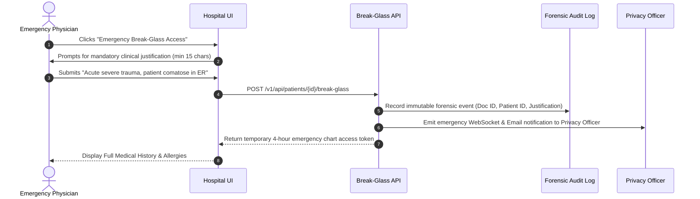

# Chapter 5: Troubleshooting, Error Handling & Runbooks
## The Practical Diagnostic Guide: Resolving Errors, Triage Runbooks & System Recovery

---

## 1. The Golden Rule of Troubleshooting: `X-Request-ID` Traceability

When a clinical user or hospital administrator encounters an error in Avinya HMS, **never guess what went wrong**. Every transaction in the system is cryptographically correlated.

### Where to Find the Request ID:
1. **In the HTTP Response Headers:** `X-Request-ID: c56a8d3e-9f12-4a7b-83c1-2e98745bc012`
2. **In the Error JSON Payload:**
   ```json
   {
     "detail": "Bed 402 is currently locked by another admission transaction.",
     "code": "CONCURRENT_LOCK_CONFLICT",
     "request_id": "c56a8d3e-9f12-4a7b-83c1-2e98745bc012"
   }
   ```
3. **In the User Interface:** Displayed at the bottom-right corner of error modal dialogues as a click-to-copy token.

### How to Search Logs with the Request ID:
Search your log aggregator (Datadog, AWS CloudWatch, Grafana Loki, or terminal):
```bash
grep "c56a8d3e-9f12-4a7b-83c1-2e98745bc012" /var/log/avinya/app.log
```
Every SQL query executed, Redis queue check, authentication validation, and error traceback for that specific user click will be printed sequentially.

---

## 2. Standard HTTP Error Code Catalog & Resolution Procedures



---

### 2.1 HTTP 401 Unauthorized

#### Scenario A: Expired JWT Token
- **Error Payload:** `{"detail": "Could not validate credentials", "code": "TOKEN_EXPIRED"}`
- **Root Cause:** Access tokens expire after 30 minutes.
- **Resolution:** Client application must automatically invoke `POST /api/identity/refresh` with the refresh token. If the refresh token has expired (after 7 days), the user must log in again with credentials and MFA.

#### Scenario B: Invalid or Desynchronized TOTP MFA Code
- **Error Payload:** `{"detail": "Invalid or expired MFA code", "code": "MFA_CODE_INVALID"}`
- **Root Cause:** The user's mobile authenticator app clock is out of sync with the server NTP clock, or the user typed the 6-digit code after the 30-second window closed.
- **Resolution:** Ensure the user's mobile device has "Automatic Date & Time" enabled. If an operator is locked out, a `superadmin` can reset their MFA secret via `POST /api/control/operators/{id}/reset-mfa`.

#### Scenario C: Session Revoked Due to Password Change
- **Root Cause:** When an administrator resets a user's password or an emergency lockout occurs, all active sessions are instantly purged from Redis.
- **Resolution:** The user must log in using the newly issued credentials.

---

### 2.2 HTTP 403 Forbidden

#### Scenario A: Module Not Licensed (`RequireLicensedModule`)
- **Error Payload:** `{"detail": "Hospital tenant has not licensed module 'bloodbank'", "code": "MODULE_NOT_LICENSED"}`
- **Root Cause:** The hospital group has not subscribed to this specific functional domain in their SaaS contract.
- **Resolution:**
  1. Open the Nexus Control Plane console.
  2. Navigate to Tenant Details ➔ Module Licenses.
  3. Toggle the desired module (e.g., `bloodbank`, `abdm`, `quality`) to Active.
  4. The license cache refreshes immediately; no container restart is required.

#### Scenario B: Insufficient Role Permissions
- **Error Payload:** `{"detail": "User lacks permission 'billing:finalize'", "code": "PERMISSION_DENIED"}`
- **Root Cause:** A ward nurse or junior resident attempted an action restricted to billing clerks or senior consultants.
- **Resolution:** If the user genuinely requires this capability, a hospital administrator must update the user's role assignment in `POST /api/identity/users/{id}/roles`.

---

### 2.3 HTTP 409 Conflict (High Concurrency & Deadlocks)

#### Scenario A: Inpatient Bed Lock Collision (`with_for_update(nowait=True)`)
- **Error Payload:** `{"detail": "Bed 402 is currently locked by another transaction", "code": "BED_LOCK_CONFLICT"}`
- **Root Cause:** Two admission clerks clicked "Confirm Bed" within the same 50 milliseconds. The first transaction acquired the row lock; the second was rejected to prevent double-booking.
- **Resolution:**
  - *Client-side:* Frontend applications should automatically catch `409` and display a gentle prompt: *"Bed 402 was just allocated by another clerk. Please select an alternate bed."*
  - *Backend:* Zero operator intervention required; database integrity was preserved.

#### Scenario B: Pharmacy Stock Race Condition
- **Root Cause:** Only 1 vial of an antibiotic remained on the shelf, and two ward nurses attempted to dispense it simultaneously.
- **Resolution:** The second transaction receives `409 Conflict`. The nurse must select a different batch lot or submit a Store Indent request to central pharmacy.

---

### 2.4 HTTP 422 Unprocessable Entity (Clinical Safety Hard Stops)

*Note: In Avinya HMS, an HTTP 422 error is frequently NOT a technical bug—it is an intentional, life-saving clinical safety gate functioning exactly as designed.*

#### Scenario A: BCMA Bedside Barcode Mismatch (Wrong Patient or Wrong Drug)
- **Error Payload:**
  ```json
  {
    "detail": "BCMA Verification Failed: Scanned wristband 'MRN-202610-00812' does not match prescription patient 'MRN-202610-00419'. ADMINISTRATION BLOCKED.",
    "code": "BCMA_PATIENT_MISMATCH"
  }
  ```
- **Root Cause:** A nurse scanned a patient's wristband, but the mobile workstation was loaded with a different patient's medication chart, OR the scanned drug barcode does not match the prescribed medication.
- **How to Handle:**
  1. **DO NOT ATTEMPT TO BYPASS.** The system has prevented a potentially fatal wrong-patient medication administration error.
  2. The nurse must physically inspect the patient's ID wristband.
  3. Verify the patient's room and bed number.
  4. Ensure the correct patient chart is active on the mobile terminal before re-scanning.

#### Scenario B: Drug-Disease Contraindication
- **Error Payload:** `{"detail": "Contraindication Hard Stop: Beta-blocker Propranolol is contraindicated in patient with active Bronchial Asthma (ICD-10 J45)", "code": "CONTRAINDICATION_HARD_STOP"}`
- **How to Handle:** The doctor must prescribe an alternative medication class (e.g., Calcium Channel Blocker) that does not provoke bronchospasms.

#### Scenario C: Three-Tier Discharge Clearance Blocked
- **Error Payload:** `{"detail": "Discharge Gate Blocked: Pharmacy clearance pending. 2 unconsumed vials of Ceftriaxone must be returned.", "code": "DISCHARGE_GATE_BLOCKED"}`
- **How to Handle:**
  1. The ward nurse must send unconsumed medication ampoules to the pharmacy counter.
  2. The pharmacist logs into `POST /api/pharmacy/returns` and credits the items.
  3. Once pharmacy clearance is `TRUE`, the billing cashier can finalize the invoice and execute discharge.

---

### 2.5 HTTP 500 Internal Server Error & 502/503 Service Unavailable

#### Scenario A: PostgreSQL Connection Pool Exhaustion
- **Symptom:** API requests become sluggish and begin failing with `500 Internal Server Error: Timeout waiting for connection from pool`.
- **Root Cause:** A sudden spike in hospital traffic exceeded the default connection pool limits (`pool_size=5, max_overflow=10`).
- **Step-by-Step Resolution:**
  1. Check active database connections:
     ```sql
     SELECT count(*), state FROM pg_stat_activity GROUP BY state;
     ```
  2. Increase pool limits in `.env`:
     ```ini
     DB_POOL_SIZE=20
     DB_MAX_OVERFLOW=30
     ```
  3. Perform a zero-downtime rolling restart of the API containers:
     ```bash
     docker compose up -d --no-deps api
     ```

#### Scenario B: Redis Broker Down / Background Worker Stalled
- **Symptom:** Synchronous APIs work, but nightly census billing, retention sweeps, and PDF invoice generation are halted.
- **Step-by-Step Resolution:** See [Runbook B](#runbook-b-recovering-stalled-redis-queue--worker-daemon) below.

---

## 3. Real-World Production Incident Runbooks

---

### Runbook A: Resolving Inpatient Bed Lock / Database Deadlock Conflicts

**When to Use:** A patient bed is reported as "stuck in locked state" or a database connection hung during a network interruption.

1. **Identify the Stuck Lock in PostgreSQL:**
   ```sql
   SELECT pid, usename, query_start, state, query
   FROM pg_stat_activity
   WHERE query LIKE '%FOR UPDATE%' AND state != 'idle';
   ```
2. **Inspect the Transaction Duration:**
   If a query has been active for more than 60 seconds, the client workstation likely crashed or lost Wi-Fi before releasing the transaction.
3. **Terminate the Stuck Backend Process Gracefully:**
   ```sql
   -- Attempt graceful cancellation first:
   SELECT pg_cancel_backend(<pid>);
   
   -- If it does not terminate within 10 seconds, force terminate:
   SELECT pg_terminate_backend(<pid>);
   ```
4. **Verify Bed State:**
   ```sql
   SELECT id, code, status FROM beds WHERE code = 'BED-402';
   ```
   The bed is now unlocked and immediately available for new admissions.

---

### Runbook B: Recovering Stalled Redis Queue & Worker Daemon

**When to Use:** Background jobs are accumulating in Redis and not executing.

1. **Check Queue Depth in Redis:**
   ```bash
   redis-cli -a $REDIS_PASSWORD LLEN avinya_default_queue
   ```
   If the count is high and not decreasing, the worker daemon is dead or hung.
2. **Inspect Worker Daemon Logs:**
   ```bash
   docker logs --tail 100 avinya_worker
   ```
3. **Restart the Worker Daemon:**
   ```bash
   docker compose restart worker
   ```
4. **Monitor Job Processing:**
   Re-run `LLEN avinya_default_queue`. The queue depth will steadily decrease as the worker consumes backlogged tasks.

---

### Runbook C: Emergency Clinical Break-Glass Triage

**When to Use:** An emergency department doctor requires immediate access to an unconscious patient's chart who was registered at another hospital branch, but normal consent permissions are missing.



**Post-Incident Audit Review:**
1. Within 24 hours of a break-glass event, the hospital Privacy Officer receives the automated report.
2. The officer reviews the justification in `GET /api/audit/break-glass-events`.
3. If the access was legitimate trauma care, the incident is flagged as `VALIDATED`. If unauthorized snooping occurred, the account is suspended and escalated to medical administration.

---

### Runbook D: Laboratory Analyzer Disconnection / MLLP Socket Failure

**When to Use:** Automated lab analyzers (Roche Cobas, Sysmex) display "Transmission Error: Remote Host Closed Connection".

1. **Verify MLLP Port Listener on Port 2575:**
   ```bash
   netstat -tuln | grep 2575
   ```
   If nothing is listening, the MLLP service container is stopped.
2. **Check for Malformed HL7 Frames in Integration Logs:**
   ```bash
   grep "MLLP_FRAME_ERROR" /var/log/avinya/integrations.log
   ```
   If an analyzer sends a message exceeding `MAX_MLLP_MESSAGE_BYTES` (1 MB) or lacks proper `\x0b` start framing, the connection drops to prevent memory poisoning.
3. **Send a Test HL7 Ping Message to Verify Socket Health:**
   ```bash
   python -m backend.domains.integrations.test_mllp_client --host localhost --port 2575
   ```
   If the script receives an `MSA|AA` ACK response, the server is healthy; the issue is localized to hospital network cables or analyzer configuration.

---

### Runbook E: Tenant Inaccessible / Subdomain Routing Failure

**When to Use:** Clinicians report: *"When accessing apollo-hyd.avinyahms.com, the browser returns 404 or connection refused."*

1. **Verify DNS & Ingress Routing:**
   ```bash
   curl -I -H "Host: apollo-hyd.avinyahms.com" http://localhost:8000/health
   ```
2. **Check Tenant Status in Nexus Control Plane:**
   ```bash
   curl -H "Authorization: Bearer $OP_TOKEN" http://localhost:8080/api/control/fleet/tenants/apollo-hyd
   ```
   Check the `status` field:
   - If `status == "SUSPENDED"`: The hospital was suspended due to billing or compliance freeze. Set status back to `ACTIVE`.
   - If `status == "MAINTENANCE"`: Maintenance mode was left on after a release. Turn maintenance mode off.
3. **Verify PostgreSQL Database Accessibility:**
   ```bash
   psql -U $DB_USER -d hms_apollo_hyd -c "SELECT count(*) FROM patients;"
   ```
   If PostgreSQL rejects the connection, verify database credentials in the Control Plane registry.

---

### Runbook F: Disaster Recovery Database Rollback

**When to Use:** A catastrophic human error occurred (e.g., an unauthorized script corrupted billing ledgers), and the tenant database must be rolled back.

1. **Locate the Pre-Restore Safety Snapshot or Latest S3 Backup:**
   ```bash
   aws s3 ls s3://avinya-backups-offhost/tenants/apollo-hyd/
   ```
2. **Verify SHA-256 Checksum Sidecar:**
   ```bash
   sha256sum -c backup_apollo_hyd_20261026.dump.sha256
   ```
3. **Execute Controlled Restore via Control Plane:**
   ```bash
   curl -X POST http://localhost:8080/api/control/fleet/tenants/apollo-hyd/restore \
     -H "Authorization: Bearer $SUPERADMIN_TOKEN" \
     -H "Content-Type: application/json" \
     -d '{"backup_file": "backup_apollo_hyd_20261026.dump", "force": true}'
   ```
   - The Control Plane automatically takes a pre-restore safety snapshot of the corrupt database.
   - Restores the clean backup.
   - Clears the tenant engine pool cache in memory.
   - Returns HTTP 200 OK with verified restored table counts.

---

*Proceed to [Chapter 6: Security, Privacy & Compliance Whitepaper](06_SECURITY_PRIVACY_AND_COMPLIANCE.md) to explore the cryptographic algorithms and statutory frameworks.*
