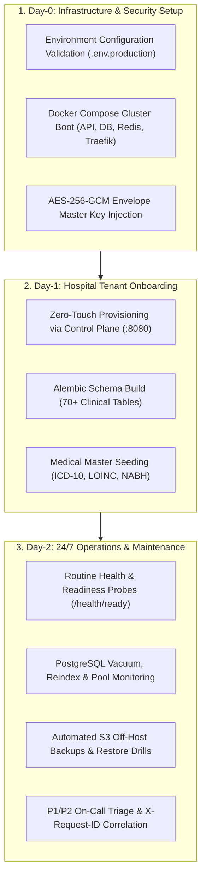
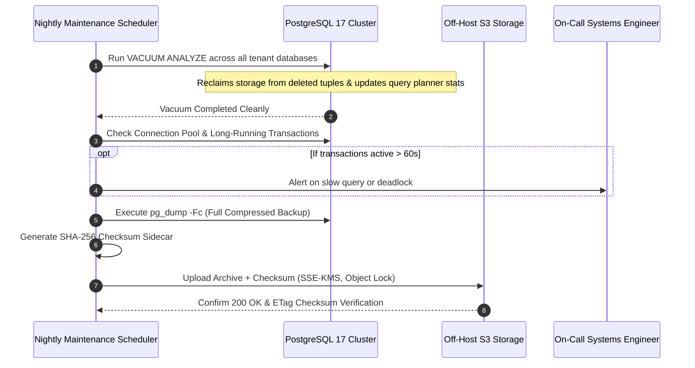
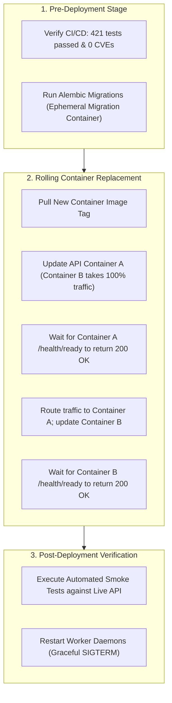

# Chapter 7: Master Operations Runbook
## The Standard Operating Procedures (SOPs), Daily Maintenance, Health Audits & Incident SLAs

---

## 1. Operational Lifecycle Overview

Running an enterprise hospital platform requires disciplined Standard Operating Procedures across three distinct operational phases:
- **Day-0 (Deployment & Cluster Initialization):** Environment validation, network topology, SSL certificate provisioning, and secret injection.
- **Day-1 (Hospital Onboarding & Cutover):** Tenant database initialization, schema migration application, catalog seeding, and integration handshakes.
- **Day-2 (Continuous Operations & Resilience):** Daily health audits, database vacuuming, queue worker pruning, off-host backups, and disaster recovery restore drills.



---

## 2. Infrastructure Startup, Containers & Health Probes

### 2.1 Cluster Services Topology
In a production deployment, the stack runs via Docker Compose or Kubernetes:
- `traefik`: Edge ingress proxy terminating TLS 1.3 and routing subdomains.
- `api`: FastAPI Hospital Tenant Engine running on port 8000.
- `control-plane`: Nexus Fleet Control Plane running on port 8080.
- `worker`: Background asynchronous queue daemon (`backend/worker.py`).
- `postgres`: PostgreSQL 17 ACID multi-tenant database cluster on port 5432.
- `redis`: Redis 8 in-memory cache, task broker, and rate limiter on port 6379.
- `clamav`: Antivirus daemon scanning uploaded medical attachments and PDFs.

### 2.2 Routine Startup Commands
```bash
# 1. Validate Compose configuration syntax
docker compose -f docker-compose.prod.yml config --quiet

# 2. Boot cluster in detached mode
docker compose -f docker-compose.prod.yml up -d

# 3. Verify running container states
docker compose -f docker-compose.prod.yml ps

# 4. Tail recent startup logs
docker compose -f docker-compose.prod.yml logs --tail=100 api control-plane worker
```

### 2.3 Health & Readiness Probes

| Endpoint | Probe Type | Description & Success Output |
| :--- | :--- | :--- |
| `GET /health` | Liveness | Lightweight ping verifying FastAPI event loop is active: `{"status": "ok", "environment": "production"}` |
| `GET /health/ready` | Readiness | Deep check verifying active connection to PostgreSQL and Redis: `{"status": "ready", "database": "connected", "redis": "connected"}` |
| `GET /metrics` | Telemetry | Prometheus metrics scrape (requires `Authorization: Bearer <METRICS_SCRAPE_TOKEN>`) |
| `GET :8080/health` | Control Plane | Verifies Nexus Control Plane database connectivity: `{"status": "ok", "control_plane": "ready"}` |

---

## 3. Daily & Weekly Database Maintenance SOP

PostgreSQL 17 handles high-volume clinical transactions 24 hours a day. Left unmaintained, dead row tuples degrade query performance and bloat disk storage.



### 3.1 Nightly Database Vacuum & Statistics Update
Run at 02:00 local time during low clinical activity:
```sql
-- Execute against all hms_{tenant_slug} databases:
VACUUM (ANALYZE, VERBOSE);
```
- **Why It Matters:** Reclaims disk space from updated eMAR orders and patient admissions; updates PostgreSQL cost-based query planner statistics for sub-millisecond index scans.

### 3.2 Identifying and Clearing Blocked Transactions & Connection Pool Bloat
If clinical users report that saving a chart or allocating a bed is hanging:
```sql
-- 1. Check for active transactions running longer than 60 seconds:
SELECT pid, usename, client_addr, state, now() - query_start AS duration, query
FROM pg_stat_activity
WHERE state != 'idle' AND (now() - query_start) > interval '60 seconds'
ORDER BY duration DESC;

-- 2. Identify blocking lock conflicts:
SELECT blocked_locks.pid AS blocked_pid,
       blocking_locks.pid AS blocking_pid,
       blocked_activity.query AS blocked_statement,
       blocking_activity.query AS current_statement_in_blocking_process
FROM pg_catalog.pg_locks blocked_locks
JOIN pg_catalog.pg_stat_activity blocked_activity ON blocked_activity.pid = blocked_locks.pid
JOIN pg_catalog.pg_locks blocking_locks 
    ON blocking_locks.locktype = blocked_locks.locktype
    AND blocking_locks.database IS NOT DISTINCT FROM blocked_locks.database
    AND blocking_locks.relation IS NOT DISTINCT FROM blocked_locks.relation
    AND blocking_locks.page IS NOT DISTINCT FROM blocked_locks.page
    AND blocking_locks.tuple IS NOT DISTINCT FROM blocked_locks.tuple
    AND blocking_locks.virtualxid IS NOT DISTINCT FROM blocked_locks.virtualxid
    AND blocking_locks.transactionid IS NOT DISTINCT FROM blocked_locks.transactionid
    AND blocking_locks.classid IS NOT DISTINCT FROM blocked_locks.classid
    AND blocking_locks.objid IS NOT DISTINCT FROM blocked_locks.objid
    AND blocking_locks.objsubid IS NOT DISTINCT FROM blocked_locks.objsubid
    AND blocking_locks.pid != blocked_locks.pid
JOIN pg_catalog.pg_stat_activity blocking_activity ON blocking_activity.pid = blocking_locks.pid
WHERE NOT blocked_locks.granted;

-- 3. Terminate the blocking query cleanly:
SELECT pg_cancel_backend(<blocking_pid>);
```

---

## 4. Redis Maintenance & Asynchronous Queue Hygiene

Redis 8 powers high-speed token blacklists, rate limiters, WebSocket pub/sub channels, and the background task queue.

### 4.1 Queue Depth & Memory Monitoring
```bash
# 1. Connect to Redis with authenticated password:
redis-cli -a $REDIS_PASSWORD

# 2. Check current queue depths:
LLEN avinya_default_queue
LLEN avinya_priority_queue

# 3. Check Redis memory consumption and eviction status:
INFO memory
# Look for: used_memory_human, maxmemory_policy (should be noeviction or volatile-lru)
```

### 4.2 Clearing Stalled or Poison Tasks
If an unhandled serialization error causes a task to crash the worker repeatedly:
```bash
# Inspect the top of the queue without removing:
LRANGE avinya_default_queue 0 2

# If a poison message is blocking the queue, pop and inspect:
RPOP avinya_default_queue
```

---

## 5. Zero-Downtime Deployment & Rolling Update Runbook

When deploying a new software release or bugfix to live hospital clusters:



### Step-by-Step Release Commands:
1. **Apply Database Migrations (Zero Downtime):**
   ```bash
   # Run migrations in an isolated one-off container before touching APIs:
   docker compose -f docker-compose.prod.yml run --rm db-init
   ```
2. **Execute Rolling API Container Update:**
   ```bash
   # Instruct Traefik / Compose to deploy new containers with zero traffic drop:
   docker compose -f docker-compose.prod.yml up -d --no-deps --scale api=2 --no-recreate api
   ```
3. **Gracefully Cycle Worker Daemons:**
   ```bash
   # Send SIGTERM to workers so they finish active jobs before restarting:
   docker compose -f docker-compose.prod.yml restart worker
   ```

---

## 6. Incident Classification, Escalation Matrix & SLAs

When production incidents occur, operations teams adhere to strict healthcare response SLAs:

| Severity Level | Operational Impact | Clinical Example | Target Response | Target Resolution | Escalation Path |
| :---: | :--- | :--- | :---: | :---: | :--- |
| **P1 - Critical** | Whole System Down / Life-Safety Threat | Database cluster unreachable; BCMA bedside safety offline; ER triage halted. | **10 Minutes** | **1 Hour** | On-Call SRE ➔ Platform Lead ➔ Chief Medical Officer |
| **P2 - High** | Major Module Offline / Workaround Available | LIS analyzer MLLP listener disconnected; Pharmacy FEFO billing failing. | **30 Minutes** | **4 Hours** | Senior DevOps ➔ Backend Domain Lead |
| **P3 - Medium** | Non-Critical Bug / Performance Degradation | Analytics report query slow; Non-clinical staff payroll report error. | **2 Hours** | **24 Hours** | L2 Support Engineer ➔ Operations Lead |
| **P4 - Low** | Cosmetic / General Administrative Request | Formatting issue on receipt PDF; department rename request. | **8 Hours** | **72 Hours** | L1 Helpdesk Desk |

### Immediate P1 Incident Protocol:
1. **Acknowledge & Declare:** Post in hospital emergency response channel: `[P1 DECLARED] System unresponsiveness detected on tenant apollo-hyd at 01:15 UTC. Incident Commander: @lead-sre`.
2. **Isolate Request Correlation:** Identify incoming `X-Request-ID` tokens from failing requests.
3. **Capture Diagnostic Snapshot:** Save output of `docker compose ps`, `pg_stat_activity`, and recent container logs before restarting services.
4. **Execute Safe Rollback:** If a bad code release caused the issue, revert container tags to the previous verified release commit (`64efd6d`).

---

*Proceed to [Chapter 8: API & Integration Reference Manual](08_API_AND_INTEGRATION_REFERENCE.md) to explore the technical integration specifications.*
