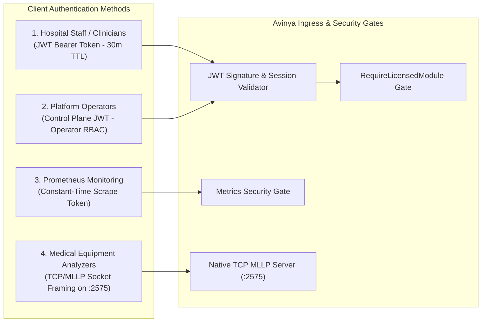
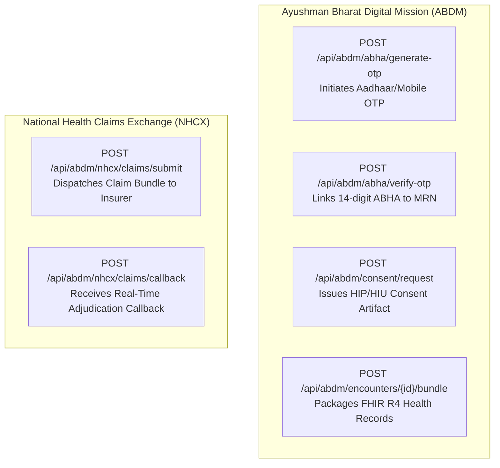

# Chapter 8: API & Integration Reference Manual
## Specifications for External Systems, Native HL7 v2 MLLP, FHIR R4 & ABDM/NHCX Gateways

---

## 1. Authentication & Security Protocols

Every API transaction in Avinya HMS is authenticated, encrypted, and cryptographically verified.



### 1.1 Clinician & Staff JWT Bearer Authentication
- **Header:** `Authorization: Bearer <access_token>`
- **Token Claims Payload:**
  ```json
  {
    "sub": "42",
    "email": "dr.sharma@apollo.com",
    "tenant_slug": "apollo-delhi",
    "roles": ["DOCTOR"],
    "permissions": ["clinical:read", "clinical:write", "cpoe:order"],
    "exp": 1730000000
  }
  ```
- **Token Expiry & Refresh:** Access tokens expire after 30 minutes. To maintain continuous clinical sessions without re-entering passwords, client applications invoke:
  `POST /api/identity/refresh` with the refresh token (valid for 7 days unless revoked).

### 1.2 Telemetry Scrape Token Gate
Prometheus scraping requires a dedicated static secret to prevent unauthorized enumeration of hospital operational volume:
`Authorization: Bearer <PROMETHEUS_SCRAPE_TOKEN>`

---

## 2. Standardized Request & Response Envelopes

### 2.1 Unified Error Response Envelope
When an operation fails (e.g., validation error, bed collision, or clinical safety stop), the API returns a structured, machine-parsable JSON envelope:

```json
{
  "detail": "BCMA Verification Failed: Medication barcode does not match prescription.",
  "code": "BCMA_DRUG_MISMATCH",
  "request_id": "9b1deb4d-3b7d-4bad-9bdd-2b0d7b3dcb6d"
}
```

- **`detail` (string):** Human-readable clinical or operational description of the issue.
- **`code` (string):** Deterministic machine code allowing frontend applications to trigger specific UI workflows (e.g., sound an alarm, prompt for alternate bed).
- **`request_id` (UUID):** The correlated transaction ID for instant log lookup.

---

## 3. Native HL7 v2.x MLLP Interface Specification (Port 2575)

Avinya HMS features a built-in TCP socket engine implementing the healthcare-standard **Minimal Lower Layer Protocol (MLLP)**. Automated clinical chemistry, hematology, and immunoassay analyzers transmit unsolicited observations directly over this port.

### 3.1 MLLP Wire Framing Format
Messages on TCP port 2575 must be encapsulated within standard hexadecimal control characters:
- **Start of Block:** `\x0b` (Vertical Tab, ASCII 11)
- **End of Block:** `\x1c\x0d` (File Separator ASCII 28 + Carriage Return ASCII 13)

### 3.2 Supported HL7 v2 Message Type: `ORU^R01` (Unsolicited Observation)
When an analyzer completes sample testing, it sends an `ORU^R01` message:

```text
MSH|^~\&|ROCHE_COBAS|LAB_CHEM|AVINYA_HMS|CENTRAL_HOSP|20261026011500||ORU^R01|MSG20261026001|P|2.3.1
PID|1||MRN-202610-00412^^^AVINYA||SHARMA^RAJESH^^^DR||19800512|M|||123 MAIN ST^^DELHI^DL^110001
PV1|1|I|ICU^BED-04^01||||12^BHATIA^SUNIL^^^DR
OBR|1|ORD-98124|ROCHE-98124|SERUM_ELECTROLYTES^Serum Electrolytes Panel|||20261026011000
OBX|1|NM|K+^Potassium|1|6.8|mEq/L|3.5-5.0|HH|||F|||20261026011400|ROCHE_COBAS
OBX|2|NM|NA+^Sodium|1|138|mEq/L|135-145|N|||F|||20261026011400|ROCHE_COBAS
```

### Segment Breakdown:
- **`MSH` (Message Header):** Sending analyzer (`ROCHE_COBAS`), message control ID, timestamp.
- **`PID` (Patient ID):** Inpatient Medical Record Number (`MRN-202610-00412`).
- **`PV1` (Patient Visit):** Current ward and bed location (`ICU^BED-04`).
- **`OBR` (Observation Request):** Diagnostic order accession number.
- **`OBX` (Observation Result):** Analyte mnemonic (`K+`), numeric value (`6.8`), unit (`mEq/L`), reference range (`3.5-5.0`), and abnormal flag (`HH` for extreme panic high).

### Automated System Response (ACK):
Within 50ms of receipt, the server returns an HL7 `ACK` message confirming persistence:
```text
MSH|^~\&|AVINYA_HMS|CENTRAL_HOSP|ROCHE_COBAS|LAB_CHEM|20261026011501||ACK|ACK20261026001|P|2.3.1
MSA|AA|MSG20261026001|Results parsed and filed successfully
```

---

## 4. HL7 FHIR R4 RESTful API Standards

The platform exposes standards-compliant **Fast Healthcare Interoperability Resources (FHIR) Release 4** endpoints under `/api/fhir/R4/`.

### 4.1 Server Metadata Statement
- **Endpoint:** `GET /api/fhir/R4/metadata`
- **Output:** FHIR `CapabilityStatement` declaring supported resources, search parameters, and JSON serialization profiles.

### 4.2 FHIR R4 Patient Resource Example
- **Endpoint:** `GET /api/fhir/R4/Patient/{id}`
- **JSON Payload:**
  ```json
  {
    "resourceType": "Patient",
    "id": "MRN-202610-00412",
    "identifier": [
      {
        "system": "https://avinyahms.com/mrn",
        "value": "MRN-202610-00412"
      }
    ],
    "active": true,
    "name": [
      {
        "use": "official",
        "family": "Sharma",
        "given": ["Rajesh"]
      }
    ],
    "gender": "male",
    "birthDate": "1980-05-12"
  }
  ```

---

## 5. National Healthcare Gateways: ABDM & NHCX



### 5.1 ABDM M1: ABHA Number Linking
- **Endpoint:** `POST /api/abdm/abha/verify-otp`
- **Payload:** `{"txn_id": "TXN-89123", "otp": "481902", "patient_id": 412}`
- **Outcome:** Stores validated 14-digit ABHA number and `@abdm` address in the patient record.

### 5.2 NHCX Claims Submission & Adjudication
- **Endpoint:** `POST /api/abdm/nhcx/claims/submit`
- **Payload:** Links finalized `Invoice` ID, TPA policy number, and diagnosis codes.
- **Outcome:** Generates an NHCX-compliant claim payload, signs it cryptographically, and records a pending entry in `NHCXClaimExchangeLog`. When the insurer adjudicates the claim, the callback updates the hospital financial ledger automatically.

---

## 6. Outbound Webhooks & Streaming Realtime Channels

### 6.1 WebSocket Realtime Alert Channels
Client applications establish authenticated WebSocket connections to receive live clinical alerts:
- **URL:** `ws://api.hospital.com/ws/tenants/{tenant_slug}/alerts?token=<JWT>`
- **Live Streams:**
  - `CHANNEL_PANIC_LAB`: Critical lab results requiring immediate doctor acknowledgment.
  - `CHANNEL_NEWS2_DETERIORATION`: Rapid Response Team emergency patient alarms.
  - `CHANNEL_BED_CENSUS`: Ward bed status transitions (`OCCUPIED`, `VACANT`, `CLEANING`).

### 6.2 Streaming SIEM Audit Export
For hospital SOC (Security Operations Center) teams ingesting audit logs:
- **Endpoint:** `GET /api/audit/siem/export?format=jsonl&since=2026-10-25T00:00:00Z`
- **Format:** Chunked HTTP streaming JSON-Lines (`.jsonl`), avoiding memory buffering on large historical exports.

---

## 7. Bedside Clinical Safety & Deterioration Protocols

### 7.1 BCMA 5-Rights Bedside Administration
- **Endpoint:** `POST /v1/api/pharmacy/bcma/verify-and-administer`
- **Verification Matrix:**
  - **Right Patient:** Matches scanned wristband MRN against active encounter patient. Rejects bare numeric database IDs (wristband machine barcode mandatory).
  - **Right Drug:** Matches scanned medication vial barcode against prescribed item master. Rejects typed brand names (machine barcode, NDC, or medication catalog code mandatory).
  - **Right Dose:** Mandatory `dose_given`. Strict tokenized numeric and normalized unit comparison (`mg`, `mcg`, `ml`, `l`, `iu`, `g`), preventing bare number matches against durations or strength strings.
  - **Right Route:** Mandatory `route`. Validates administration route (`ORAL`, `IV`, `IM`, `SC`, `INTRATHECAL`, `TOPICAL`) against prescription specifications. For injectable formulations (`INJECTION`, `INFUSION`) without specific prescription route, permits parenteral routes (`IV`, `IM`, `SC`, `INTRATHECAL`).
  - **Right Time:** Checks administration window against scheduled administration frequency (+/- 60 minutes).
- **Audit Response:**
  ```json
  {
    "is_verified": true,
    "route_matched": true,
    "failure_reason": null,
    "prescription_item_id": 104,
    "scanned_patient_mrn": "MRN-202610-00412",
    "scanned_medication_code": "MED-CIPRO-500",
    "scanned_at": "2026-10-27T04:20:00Z"
  }
  ```

### 7.2 Controlled Substances (Narcotics) Perpetual Vault & Dual-Witness Register
- **Vault Register:** `POST /v1/api/pharmacy/controlled-substances/vault` initializes a double-locked perpetual safe register with tamper seal tracking.
- **Stock Replenishment:** `POST /v1/api/pharmacy/controlled-substances/receipt` mandates independent secondary witness authentication and procurement/PO intake reference (min 5 chars).
- **Perpetual Safe Dispense:** `POST /v1/api/pharmacy/controlled-substances/dispense` enforces strict clinical destination validation (`encounter_id`, `prescription_item_id`, or ward destination notes >= 10 chars, rejecting trivial single-letter notes).
- **Unused Narcotic Return:** `POST /v1/api/pharmacy/controlled-substances/return` mandates independent secondary witness verification and clinical justification / encounter linking (min 10 chars).
- **Dual-Witness Wastage Destruction:** `POST /v1/api/pharmacy/controlled-substances/waste` enforces independent licensed healthcare witness password verification (self-witness strictly blocked), rate-limited witness authentication, and clinical destruction notes (min 5 chars).

### 7.3 NEWS2 Physiological Deterioration Scoring & Completeness
- **Endpoint:** `POST /v1/api/clinical/news2`
- **Clinical Safety Rules:**
  - Aggregates score (0-20) across 7 vital parameters (Respiration Rate, SpO2, Supplemental O2, Systolic BP, Heart Rate, Consciousness Level, Temperature).
  - Categorizes risk tier: `LOW` (0-4), `MEDIUM` (5-6 or 3 in single parameter), `HIGH` (7+).
  - Enforces mandatory completeness checks: returns `is_complete_set: bool` and `missing_parameters: list[str]`. If vital parameters are omitted (including consciousness level), low aggregate scores trigger `INCOMPLETE_DATA` warning recommendations rather than false routine reassurances.

### 7.4 Native HL7 v2 Result Status Handling & LIS Safety
- **Preliminary Results (`OBX-11 = P`):** Records preliminary values with `[PRELIMINARY: ...]` notice, setting diagnostic task status to `IN_PROGRESS` and setting computed API response flag `is_preliminary: true` while keeping master order status `ACTIVE`.
- **Unobtainable / Hemolyzed Specimens (`OBX-11 = X`):** Marks diagnostic task `SAMPLE_REJECTED`, populates rejection reason, clears `result_value = None`, appends specimen rejection and re-collection note, broadcasts `lab_specimen_alerts`, keeps parent order status `ACTIVE` (never closes single-test orders as `COMPLETED`), and safely skips delta-check calculations.

---

*Proceed to [Chapter 9: Database Schema & Data Dictionary](09_DATABASE_SCHEMA_AND_DATA_DICTIONARY.md) to inspect the 70+ relational tables and constraint architectures.*
