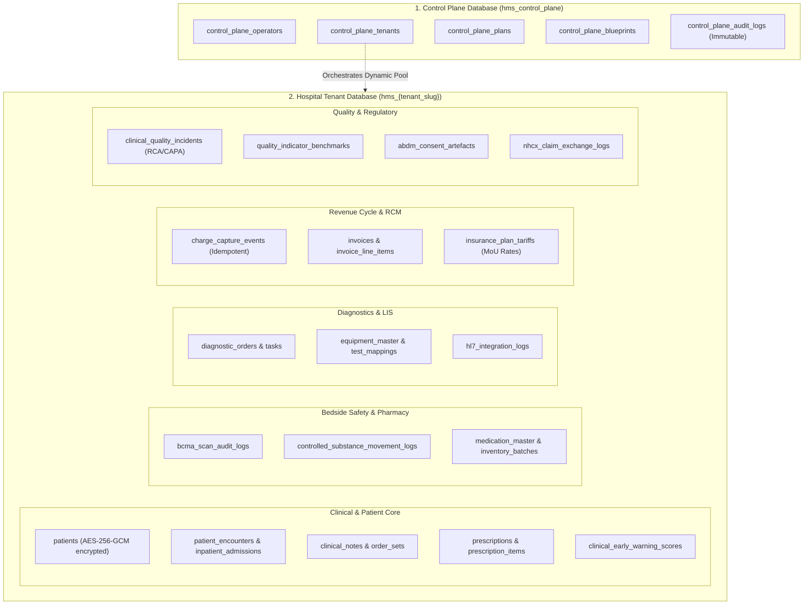

# Chapter 9: Database Schema & Data Dictionary
## Complete Relational Schema, Field Constraints, Foreign Keys & Sandbox Classifications

---

## 1. Schema Architecture Overview

Avinya HMS manages data across two distinct database tiers:
1. **The Control Plane Database (`hms_control_plane`):** Stores SaaS tenant registrations, operator credentials, subscription billing contracts, and immutable administrative audit trails.
2. **The Tenant Database Cluster (`hms_{tenant_slug}`):** Completely isolated relational databases per hospital facility, containing over 70 tables partitioned into 26 modular domain packages.

---

## 2. Exhaustive Data Dictionary (Core Clinical & Financial Tables)

### 2.1 Patient & Identity Tables

#### Table: `patients`
Stores master patient demographic records. Sensitive PII fields are encrypted at rest using AES-256-GCM.
- `id` (INTEGER, PK, Autoincrement): Internal relational primary key.
- `mrn` (VARCHAR(50), UNIQUE, NOT NULL, Index): Universal Medical Record Number (`MRN-YYYYMM-XXXXXX`).
- `full_name` (VARCHAR(150), NOT NULL): Legal name of patient.
- `date_of_birth` (DATE, NOT NULL): Birth date for age and pediatric dosage calculations.
- `gender` (ENUM `GenderEnum`, NOT NULL): `MALE`, `FEMALE`, `OTHER`.
- `blood_group` (ENUM `BloodGroupEnum`, NULLABLE): `A_POS`, `B_POS`, `O_POS`, `AB_POS`, `A_NEG`, `B_NEG`, `O_NEG`, `AB_NEG`.
- `enc_aadhaar` (TEXT, NULLABLE): Column-level AES-256-GCM encrypted Government National ID.
- `enc_phone` (TEXT, NULLABLE): Column-level AES-256-GCM encrypted primary contact phone.
- `enc_email` (TEXT, NULLABLE): Column-level AES-256-GCM encrypted email.
- `abha_address` (VARCHAR(100), NULLABLE, Index): Ayushman Bharat Digital Mission identifier (`@abdm`).
- `pincode` (VARCHAR(10), NULLABLE): Standardized postal PIN code.
- `created_at`, `updated_at` (TIMESTAMPTZ, NOT NULL): Audit timestamps.

#### Table: `patient_encounters`
Represents an official clinical episode (Outpatient consultation, Emergency visit, or Inpatient stay).
- `id` (INTEGER, PK, Autoincrement)
- `encounter_number` (VARCHAR(50), UNIQUE, NOT NULL, Index): Tracking token (e.g., `ENC-202610-00124`).
- `patient_id` (INTEGER, FK ➔ `patients.id`, NOT NULL, Index)
- `encounter_type` (ENUM `EncounterTypeEnum`, NOT NULL): `OPD`, `IPD`, `EMERGENCY`.
- `status` (ENUM `EncounterStatusEnum`, NOT NULL): `SCHEDULED`, `CHECKED_IN`, `IN_CONSULTATION`, `ADMITTED`, `DISCHARGED`, `CANCELLED`.
- `attending_doctor_id` (INTEGER, FK ➔ `users.id`, NOT NULL)
- `chief_complaint` (TEXT, NULLABLE)
- `created_at`, `updated_at` (TIMESTAMPTZ, NOT NULL)

---

### 2.2 Inpatient Bed Management & ADT

#### Table: `inpatient_admissions`
Manages hospitalization episodes and 3-tier discharge clearance states.
- `id` (INTEGER, PK, Autoincrement)
- `admission_number` (VARCHAR(50), UNIQUE, NOT NULL, Index): `ADM-202610-00084`.
- `patient_id` (INTEGER, FK ➔ `patients.id`, NOT NULL)
- `encounter_id` (INTEGER, FK ➔ `patient_encounters.id`, NOT NULL)
- `bed_id` (INTEGER, FK ➔ `beds.id`, NOT NULL)
- `is_clinical_cleared` (BOOLEAN, DEFAULT FALSE, NOT NULL): Key 1 of discharge gate.
- `is_pharmacy_cleared` (BOOLEAN, DEFAULT FALSE, NOT NULL): Key 2 of discharge gate.
- `is_billing_cleared` (BOOLEAN, DEFAULT FALSE, NOT NULL): Key 3 of discharge gate.
- `admitted_at` (TIMESTAMPTZ, NOT NULL)
- `discharged_at` (TIMESTAMPTZ, NULLABLE)

#### Table: `beds`
Physical ward beds subject to atomic row locking (`FOR UPDATE NOWAIT`).
- `id` (INTEGER, PK, Autoincrement)
- `code` (VARCHAR(30), UNIQUE, NOT NULL): E.g., `ICU-BED-04`, `WARD-3-BED-12`.
- `room_id` (INTEGER, FK ➔ `rooms.id`, NOT NULL)
- `status` (ENUM `BedStatusEnum`, NOT NULL): `VACANT`, `OCCUPIED`, `MAINTENANCE`, `DIRTY`, `CLEANING`.
- `daily_rate_paise` (INTEGER, NOT NULL): Base bed rental charge in paise (INR cents).

---

### 2.3 Clinical Decision Support & Order Sets

#### Table: `order_sets`
Standardized clinical care bundles.
- `id` (INTEGER, PK, Autoincrement)
- `code` (VARCHAR(50), UNIQUE, NOT NULL, Index): E.g., `SEPSIS_BUNDLE_ADULT`, `ACS_PROTOCOL`.
- `name` (VARCHAR(150), NOT NULL): Descriptive title.
- `bundle_type` (ENUM `OrderSetTypeEnum`, NOT NULL): `ADMISSION`, `CRITICAL_CARE`, `SURGICAL_PREP`, `DISEASE_PROTOCOL`.
- `items_payload` (JSON, NOT NULL): Structured JSON schema defining all multi-disciplinary orders to generate.
- `is_active` (BOOLEAN, DEFAULT TRUE, NOT NULL)

#### Table: `clinical_early_warning_scores`
Stores calculated physiological deterioration metrics (NEWS2).
- `id` (INTEGER, PK, Autoincrement)
- `patient_id` (INTEGER, FK ➔ `patients.id`, NOT NULL, Index)
- `encounter_id` (INTEGER, FK ➔ `patient_encounters.id`, NOT NULL, Index)
- `respiration_rate` (INTEGER, NOT NULL)
- `spo2_percentage` (INTEGER, NOT NULL)
- `on_supplemental_oxygen` (BOOLEAN, NOT NULL)
- `systolic_bp` (INTEGER, NOT NULL)
- `pulse_bpm` (INTEGER, NOT NULL)
- `avpu_consciousness` (VARCHAR(20), NOT NULL): `ALERT`, `VOICE`, `PAIN`, `UNRESPONSIVE`.
- `temperature_celsius` (FLOAT, NOT NULL)
- `total_news2_score` (INTEGER, NOT NULL): Aggregate score (0 to 20).
- `clinical_risk_tier` (VARCHAR(20), NOT NULL): `LOW`, `MEDIUM`, `HIGH`.
- `escalation_triggered` (BOOLEAN, DEFAULT FALSE, NOT NULL): True if Rapid Response Team was alerted.

---

### 2.4 Bedside Safety & Controlled Substances

#### Table: `bcma_scan_audit_logs`
Forensic bedside scan validation audit trail (BCMA 5-rights enforcement).
- `id` (INTEGER, PK, Autoincrement)
- `encounter_id` (INTEGER, FK ➔ `patient_encounters.id`, NOT NULL, Index)
- `prescription_item_id` (INTEGER, FK ➔ `prescription_items.id`, NOT NULL, Index)
- `administered_by_id` (INTEGER, FK ➔ `users.id`, NOT NULL)
- `scanned_patient_barcode` (VARCHAR(100), NOT NULL): Barcode read from wristband (rejects bare numeric patient IDs).
- `scanned_medication_barcode` (VARCHAR(100), NOT NULL): Barcode read from drug packaging (rejects typed brand names).
- `patient_matched` (BOOLEAN, NOT NULL): Wristband MRN match verification.
- `medication_matched` (BOOLEAN, NOT NULL): Medication NDC/barcode match.
- `dose_matched` (BOOLEAN, DEFAULT TRUE, NOT NULL): Normalized dose match verification.
- `route_matched` (BOOLEAN, DEFAULT TRUE, NOT NULL): Clinical route alignment verification.
- `time_status` (VARCHAR(30), DEFAULT 'ON_TIME', NOT NULL): `ON_TIME`, `EARLY`, `LATE`, `PRN`.
- `verification_status` (VARCHAR(50), NOT NULL): `VERIFIED`, `WARNING_OVERRIDDEN`, `BLOCKED_MISMATCH`.
- `override_reason` (VARCHAR(500), NULLABLE): Clinical explanation for warnings.
- `emar_log_id` (INTEGER, FK ➔ `medication_administration_logs.id`, NULLABLE)
- `scanned_at` (TIMESTAMPTZ, NOT NULL)

#### Table: `controlled_substance_vaults`
Perpetual double-locked narcotics safe registers.
- `id` (INTEGER, PK, Autoincrement)
- `medication_id` (INTEGER, FK ➔ `medication_master.id`, UNIQUE, NOT NULL)
- `vault_location` (VARCHAR(100), NOT NULL): E.g., `MAIN_NARCOTICS_SAFE`, `ICU_SAFE_01`.
- `current_balance_units` (INTEGER, CHECK >= 0, NOT NULL): Real-time perpetual safe inventory balance.
- `unit_of_measure` (VARCHAR(30), NOT NULL): E.g., `AMPOULE`, `VIAL`, `TABLET`.
- `tamper_seal_number` (VARCHAR(50), NULLABLE): Physical security seal identifier.
- `is_locked` (BOOLEAN, DEFAULT TRUE, NOT NULL)

#### Table: `controlled_substance_movement_logs`
Auditable perpetual movement log for narcotics receipts, dispenses, returns, and dual-witness wastage.
- `id` (INTEGER, PK, Autoincrement)
- `vault_id` (INTEGER, FK ➔ `controlled_substance_vaults.id`, NOT NULL, Index)
- `movement_type` (VARCHAR(30), NOT NULL): `RECEIPT`, `DISPENSE`, `RETURN_TO_VAULT`, `WASTAGE_DESTROYED`.
- `quantity_units` (INTEGER, CHECK > 0, NOT NULL)
- `balance_before` (INTEGER, NOT NULL)
- `balance_after` (INTEGER, CHECK >= 0, NOT NULL)
- `encounter_id` (INTEGER, FK ➔ `patient_encounters.id`, NULLABLE)
- `prescription_item_id` (INTEGER, FK ➔ `prescription_items.id`, NULLABLE)
- `primary_user_id` (INTEGER, FK ➔ `users.id`, NOT NULL): Primary licensed nurse / pharmacist.
- `witness_user_id` (INTEGER, FK ➔ `users.id`, NULLABLE): Mandatory independent second witness for safe receipt, return, and wastage.
- `witness_verified` (BOOLEAN, DEFAULT FALSE, NOT NULL): True when witness credentials successfully authenticated.
- `wastage_reason` (VARCHAR(255), NULLABLE): Clinical disposal justification.
- `disposal_method` (VARCHAR(100), NULLABLE): Safe destruction method.
- `batch_number` (VARCHAR(50), NULLABLE)
- `notes` (VARCHAR(500), NULLABLE)
- `created_at` (TIMESTAMPTZ, NOT NULL, Index)

---

### 2.5 Diagnostic Laboratory & MLLP Interfaces

#### Table: `equipment_test_mappings`
Maps external biomedical analyzer mnemonics to internal service catalog IDs.
- `id` (INTEGER, PK, Autoincrement)
- `equipment_id` (INTEGER, FK ➔ `equipment_master.id`, NOT NULL, Index)
- `analyzer_test_code` (VARCHAR(50), NOT NULL, Index): Machine mnemonic (e.g., `K+`, `HGB`, `GLUC`).
- `service_id` (INTEGER, FK ➔ `service_catalog.id`, NOT NULL, Index): Internal hospital billing and reporting test ID.
- `units` (VARCHAR(30), NULLABLE): Unit of measurement (`mEq/L`, `mg/dL`).
- `is_active` (BOOLEAN, DEFAULT TRUE, NOT NULL)

#### Table: `hl7_integration_logs`
Audit trail of raw HL7 v2 messages received on MLLP port 2575.
- `id` (INTEGER, PK, Autoincrement)
- `equipment_id` (INTEGER, FK ➔ `equipment_master.id`, NULLABLE)
- `message_control_id` (VARCHAR(100), NOT NULL, Index): MSH-10 identifier.
- `raw_payload` (TEXT, NOT NULL): Complete wire payload.
- `parsed_order_id` (VARCHAR(100), NULLABLE, Index)
- `status` (VARCHAR(50), NOT NULL): `RECEIVED`, `PARSED`, `FILED`, `ERROR`.
- `error_details` (TEXT, NULLABLE)

---

### 2.6 Revenue Cycle Management & Billing

#### Table: `invoices`
Consolidated patient financial billing statement and tax ledger.
- `id` (INTEGER, PK, Autoincrement)
- `invoice_number` (VARCHAR(50), UNIQUE, NOT NULL, Index): Tracking token (`INV-YYYYMM-XXXX`).
- `patient_id` (INTEGER, FK ➔ `patients.id`, NOT NULL, Index)
- `encounter_id` (INTEGER, FK ➔ `patient_encounters.id`, NULLABLE, Index)
- `total_amount` (NUMERIC(12, 2), NOT NULL): Pre-tax gross subtotal.
- `tax_amount` (NUMERIC(12, 2), DEFAULT 0.0, NOT NULL): Aggregate GST.
- `discount_amount` (NUMERIC(12, 2), DEFAULT 0.0, NOT NULL)
- `final_amount` (NUMERIC(12, 2), NOT NULL): Net payable balance.
- `paid_amount` (NUMERIC(12, 2), DEFAULT 0.0, NOT NULL)
- `status` (ENUM `InvoiceStatusEnum`, NOT NULL): `DRAFT`, `FINALIZED`, `PAID`, `CANCELLED`.
- `is_interstate` (BOOLEAN, DEFAULT FALSE, NOT NULL): Flag designating IGST vs dual CGST+SGST statutory tax determination.
- `created_at`, `updated_at` (TIMESTAMPTZ, NOT NULL)

#### Table: `charge_capture_events`
Idempotent operational charge ledger.
- `id` (INTEGER, PK, Autoincrement)
- `source_reference` (VARCHAR(100), UNIQUE, NOT NULL, Index): Idempotency key (e.g., `CENSUS-ADM102-BED4-20261026`).
- `encounter_id` (INTEGER, FK ➔ `patient_encounters.id`, NOT NULL, Index)
- `service_id` (INTEGER, FK ➔ `service_catalog.id`, NOT NULL)
- `quantity` (INTEGER, DEFAULT 1, NOT NULL)
- `unit_price_paise` (INTEGER, NOT NULL): Resolved unit price after tariff contract evaluation.
- `total_price_paise` (INTEGER, NOT NULL)
- `billing_status` (ENUM, NOT NULL): `PENDING_POST`, `POSTED_TO_INVOICE`, `REVERSED`.

#### Table: `insurance_plan_tariffs`
Contractually negotiated multi-tariff rate cards with TPAs and insurers.
- `id` (INTEGER, PK, Autoincrement)
- `insurance_plan_id` (INTEGER, FK ➔ `insurance_plans.id`, NOT NULL, Index)
- `service_id` (INTEGER, FK ➔ `service_catalog.id`, NOT NULL, Index)
- `negotiated_rate_paise` (INTEGER, NOT NULL): Contractually agreed procedure rate.
- `co_pay_percentage` (FLOAT, DEFAULT 0.0, NOT NULL): Patient copay share.
- `max_room_rent_daily_paise` (INTEGER, NULLABLE): Statutory daily room rent cap under policy terms.

---

### 2.7 Quality Accreditations (NABH / JCI)

#### Table: `clinical_quality_incidents`
Clinical adverse event reporting with root cause analysis and corrective action tracking.
- `id` (INTEGER, PK, Autoincrement)
- `incident_code` (VARCHAR(50), UNIQUE, NOT NULL, Index): `QI-YYYYMM-XXXX`.
- `incident_type` (ENUM, NOT NULL): `CAUTI`, `CLABSI`, `VAP`, `SSI`, `PATIENT_FALL`, `BEDSORE_HAPU`, `MEDICATION_ERROR`, `SENTINEL_EVENT`.
- `severity` (ENUM, NOT NULL): `NEAR_MISS`, `MINOR`, `MODERATE`, `MAJOR`, `SENTINEL`.
- `patient_id` (INTEGER, FK ➔ `patients.id`, NULLABLE, Index)
- `device_days` (INTEGER, NULLABLE): Catheter/ventilator days associated with device-related infection.
- `description` (TEXT, NOT NULL)
- `root_cause_analysis` (TEXT, NULLABLE): Documented 5-Whys or Ishikawa fishbone analysis.
- `capa_plan` (TEXT, NULLABLE): Corrective and Preventive Action plan.
- `status` (ENUM, NOT NULL): `REPORTED`, `UNDER_REVIEW`, `CAPA_ASSIGNED`, `RESOLVED`, `CLOSED`.

---

## 3. Sandbox Sanitizer Schema Classification Matrix

When cloning a production database into an isolated test sandbox, the **Sandbox Sanitizer** (`backend/control_plane/services/sandbox_sanitizer.py`) guarantees that **100% of tables** are classified:

| Table Category | Sanitizer Behavior | Tables Included in Classification |
| :--- | :--- | :--- |
| **`MASTER_AND_CONFIG_TABLES`** | **Preserved Intact:** Retains master hospital clinical and operational configurations. | `departments`, `diagnoses_master`, `allergies_master`, `service_catalog`, `medication_master`, `equipment_master`, `equipment_test_mappings`, `insurance_plans`, `insurance_plan_tariffs`, `quality_indicator_benchmarks`, `roles`, `role_permissions`, `wards`, `rooms`, `beds`. |
| **`PURGED_LOG_TABLES`** | **Completely Deleted:** Wipes sensitive security tokens, passwords, and external audit logs. | `auth_sessions`, `password_reset_tokens`, `control_plane_audit_logs`, `hl7_integration_logs`, `clinical_access_logs`. |
| **`SCRUBBED_DATA_TABLES`** | **Deterministically Masked:** Replaces patient demographics and clinical documentation with synthetic placeholders. | `patients`, `patient_encounters`, `inpatient_admissions`, `clinical_notes`, `prescriptions`, `invoices`, `payments`, `charge_capture_events`, `bcma_scan_audit_logs`, `clinical_quality_incidents`, `users` (passwords reset to `SandboxPassword123!`, TOTP MFA secrets set to `NULL`). |

---

*Proceed to [Chapter 10: Testing, Quality Assurance & Release Governance](10_TESTING_QA_AND_RELEASE_GOVERNANCE.md) to inspect the 451-test verification harness.*
