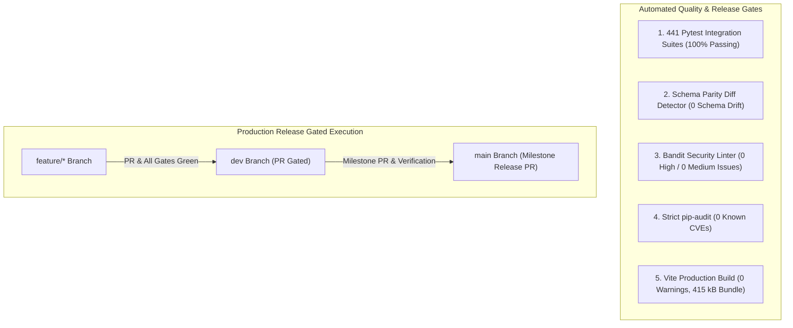

# Chapter 10: Testing, Quality Assurance & Release Governance
## The 441-Test Verification Harness, Security Gates & CI/CD Release Protocols

---

## 1. Testing Philosophy & Quality Strategy

Healthcare systems cannot rely on manual quality assurance alone. A missed edge case in medication dosing or a race condition in inpatient bed allocation can lead to fatal patient outcomes.

Avinya HMS enforces an automated, multi-layered testing pyramid:
- **Unit & Domain Tests:** Fast, in-memory validation of clinical formulas (e.g., NEWS2 scoring, pediatric dosage, tokenized BCMA dosage matching, GST tax split).
- **Multi-Tenant Integration Tests:** End-to-end API workflows executed against dynamic tenant database pools, verifying isolation, permissions, and atomic locks.
- **Schema Parity Verification:** Automated comparison between Alembic migration histories and SQLAlchemy declarative models (`Base.metadata`), guaranteeing zero schema drift.
- **Static Application Security Testing (SAST):** AST security analysis (Bandit: 0 High / 0 Medium) and strict dependency CVE checking (`pip-audit`: 0 known vulnerabilities).



---

## 2. Complete Inventory of the 63 Test Suites

The test suite contains **441 passing tests, 2 skipped across 63 test modules** in `tests/`:

| Test Suite File | Domain & Responsibility Verified |
| :--- | :--- |
| `tests/test_01_system_and_tenancy.py` | Multi-tenant dynamic database routing, subdomain resolution, and tenant engine pool. |
| `tests/test_02_iam_and_rbac_matrix.py` | Argon2id hashing, RFC 6238 TOTP MFA, permission tokens, role inheritance, session revocation. |
| `tests/test_03_mpi_and_clinical_mdm.py` | Master Patient Index, universal MRN format, AES-256-GCM envelope encryption for demographics. |
| `tests/test_04_wards_opd_and_adt.py` | OPD queues, tokens, inpatient admissions, bed state transitions, and atomic row locking. |
| `tests/test_05_diagnostics_and_lis.py` | LOINC/CPT test orders, specimen tracking, two-tier pathologist verification, panic lab alerts. |
| `tests/test_06_pharmacy_and_billing.py` | Pharmacy item master, FEFO batch dispensation, expiry alerts, return credit notes. |
| `tests/test_07_federation_and_backups.py` | Inter-hospital federated query exchange and corporate group regex routing (`re.split`). |
| `tests/test_08_emr_vitals_and_reports.py` | Doctor SOAP notes, ICD-10 diagnosis coding, vital signs, fluid balance intake/output. |
| `tests/test_09_insurance_and_auto_billing.py`| TPA insurance policy linking, pre-auth, copay, advance deposit drawdown & restoration on receipt reversal, insurance receipt deletion protection, and rejected claim settlement prevention. |
| `tests/test_10_nursing_emar_and_er_mlc.py` | Nursing eMAR medication administration, ER triage (Red/Yellow/Green), Medico-Legal Cases. |
| `tests/test_11_operation_theatre_and_surgery.py` | OT scheduling, surgical team rosters, PAC clearance, WHO Surgical Safety Checklists, and terminal state machine transition enforcement (`COMPLETED`/`CANCELLED`). |
| `tests/test_12_blood_bank_and_radiology_pacs.py` | Blood donor registry, viral serology, cross-matching, issue-time blood bag expiry check (`DISCARDED` status & 409 Conflict), and DICOM viewer deep-linking. |
| `tests/test_13_control_plane_and_executive_analytics.py` | SaaS tenant provisioning, subscription billing, executive hospital KPIs (BOR, ALOS). |
| `tests/test_14_pharmacy_returns_leaves_and_panic_labs.py` | Pharmacy batch returns with automated invoice GST recalculation, inpatient leave passes, and panic lab alert broadcasts. |
| `tests/test_15_birth_death_registries_and_discharge_gate.py` | Birth/death certificates, and the three-tier discharge clearance gate. |
| `tests/test_16_websocket_and_realtime_events.py` | WebSocket manager, authenticated token subscriptions, Redis Pub/Sub live alerts. |
| `tests/test_17_zero_touch_admin_and_control_plane.py` | Automated zero-touch tenant database provisioning from hospital blueprints. |
| `tests/test_18_finance_and_equipment.py` | Accounts payable, vendor invoices, payment vouchers, 3-way matching, expense adjudication state guard (strictly `PENDING_APPROVAL`), and equipment maintenance. |
| `tests/test_19_concurrency_and_edge_cases.py` | High-concurrency race condition tests on bed allocation and medication stock. |
| `tests/test_20_control_plane_catalogs.py` | Dynamic pricing plans, hospital blueprints, and catalog seeding. |
| `tests/test_21_control_plane_migrations.py` | Schema parity diff detector comparing Alembic migrations against `Base.metadata`. |
| `tests/test_22_domain_package_boundaries.py` | Strict package encapsulation testing preventing unauthorized cross-domain SQL joins. |
| `tests/test_23_compose_redis_config.py` | Production Docker Compose environment and Redis password authentication validation. |
| `tests/test_24_mail_and_document_profiles.py` | PDF invoice document rendering, cryptographic timestamping, and email delivery. |
| `tests/test_25_procurement.py` | Purchase requisitions, purchase orders, goods receipt notes (GRN), and vendor scoring. |
| `tests/test_26_production_environment_validation.py` | Verifies production security gates (disabled `/docs`, scrape token on `/metrics`). |
| `tests/test_27_load_profile.py` | High-throughput concurrent simulated hospital load testing. |
| `tests/test_28_control_plane_lifespan.py` | Clean startup and shutdown engine disposal in FastAPI lifespan context. |
| `tests/test_29_persistent_invoice_documents.py` | Immutable PDF invoice storage and hash verification. |
| `tests/test_30_vendor_invoice_workflow.py` | Vendor invoice approvals, payment schedules, and 3-way matching reconciliation. |
| `tests/test_31_analytics_api.py` | Accounts Receivable (AR) aging matrices (0-30, 31-60, 61-90, 90+ days). |
| `tests/test_32_identity_lifecycle.py` | Staff onboarding, password changes, emergency lockout, and session revocation. |
| `tests/test_33_control_plane_operator_auth.py` | Operator RBAC permissions (`superadmin`, `ops`, `support`, `billing`, `viewer`). |
| `tests/test_34_fhir_patient.py` | HL7 FHIR R4 standard JSON serialization for Patient resources. |
| `tests/test_35_break_glass_access.py` | Emergency break-glass clinical chart override with forensic audit verification. |
| `tests/test_36_hospital_support_services.py` | Ambulance dispatch, dietary meal planning, CSSD autoclave, mortuary registers. |
| `tests/test_37_privacy_governance.py` | DPDP Act 2023 purpose-specific consent notices and digital signatures. |
| `tests/test_38_privacy_policy_engine.py` | DPDP retention policy revisions, approvals, and legal hold overrides. |
| `tests/test_39_dpdp_compliance_workflows.py` | Data Principal Rights (Access, Correction, Erasure) and breach incident logging. |
| `tests/test_40_background_worker_and_queue.py` | Redis queue worker, JSON named handlers, forced dry-run retention sweeps. |
| `tests/test_41_observability_and_metrics.py` | Prometheus metrics scrape gate security and constant-time bearer token check. |
| `tests/test_42_drug_drug_interactions.py` | Cross-encounter DDI checks and exact word-boundary regex matching preventing false-positive cross-match alerts. |
| `tests/test_43_siem_audit_export.py` | Streaming SIEM JSON export and DNS-resolved SSRF network boundary defenses. |
| `tests/test_44_patient_invoice_tax_and_gst.py` | Statutory GST line-item tax calculation (CGST, SGST, IGST) and tax-inclusive discounts. |
| `tests/test_45_offhost_backups_and_restore_drills.py` | S3 off-host backup delivery, SSE-KMS, SHA-256 sidecars, and automated restore drills. |
| `tests/test_46_sandbox_scrubbing_and_classification.py` | 100% database table classification and synthetic data masking in sandboxes. |
| `tests/test_46_statutory_payroll_and_audit_unlock.py` | Statutory payroll deductions (PF, ESI, TDS, PTax) and locked period audit controls. |
| `tests/test_47_biomedical_waste_management.py` | Biomedical waste color categories (Yellow, Red, White, Blue) and CBWTF manifests. |
| `tests/test_48_cpoe_order_sets_news2_and_delta_checks.py` | CPOE protocol order sets, NEWS2 scoring, drug-disease contraindications with word-boundary matching, LIS delta checks. |
| `tests/test_49_bcma_and_controlled_substances.py` | Bedside BCMA 5-rights barcode validation with strict tokenized float and unit dosage matching, and Schedule H/X narcotics perpetual vault. |
| `tests/test_50_rcm_charge_master_and_tariffs.py` | Multi-tariff MoU rate cards, daily room rent caps, and automated midnight census runs. |
| `tests/test_51_abdm_and_nhcx_gateways.py` | ABDM M1 (ABHA), M2 (Consent), M3 (FHIR Bundles), and NHCX claims exchange gateway. |
| `tests/test_52_hl7_mllp_analyzer_interface.py` | Native HL7 v2 MLLP unsolicited ORU^R01 parser, equipment test mappings, and panic alerts. |
| `tests/test_53_nabh_quality_indicators.py` | NABH 5th Ed / JCI 7th Ed quality indicators (CAUTI, CLABSI, VAP, SSI, Falls) and CAPA register. |
| `tests/test_backup_service.py` | Off-host backup archive creation and SHA-256 integrity sidecar validation. |
| `tests/test_envelope.py` | Column-level AES-256-GCM envelope encryption and key rotation. |
| `tests/test_postgres17_integration.py` | Live PostgreSQL 17 multi-tenant migration parity and restore validation (CI opt-in). |
| `tests/test_developer_scripts.py` | Unit tests for developer CLI scripts (operator provisioning, key generation, database reset guard, seed, migrate aliases). |

---

## 3. How to Execute Tests

### 3.1 Local Fast Test Execution
Run the complete regression suite in the local environment:
```bash
python -m pytest tests/
```
- **Execution Time:** ~2-5 minutes for all 443 tests.
- **Expected Result:** `441 passed, 2 skipped (100% pass rate)`. (The 2 skipped tests are physical PostgreSQL 17 container tests that execute in dedicated CI environments).

### 3.2 Running Specific Domain Test Suites
```bash
# Test Clinical Safety (CPOE, NEWS2, DDI, Delta Checks):
python -m pytest tests/test_48_cpoe_order_sets_news2_and_delta_checks.py

# Test Bedside BCMA & Controlled Substances:
python -m pytest tests/test_49_bcma_and_controlled_substances.py

# Test Revenue Cycle Management & Midnight Census:
python -m pytest tests/test_50_rcm_charge_master_and_tariffs.py

# Test Native HL7 v2 MLLP Analyzer Interface:
python -m pytest tests/test_52_hl7_mllp_analyzer_interface.py

# Test NABH / JCI Clinical Quality Indicators:
python -m pytest tests/test_53_nabh_quality_indicators.py

# Test Developer and Operator CLI Scripts:
python -m pytest tests/test_developer_scripts.py
```

### 3.3 Running Automated Security Scans
```bash
# 1. Run Bandit AST security scan (Medium & High severity):
python -m bandit -r backend/ -ll

# 2. Run pip-audit dependency vulnerability scanner:
python -m pip_audit -r requirements.txt
```

---

## 4. CI/CD Release Gates & Branching Strategy

The repository strictly enforces a two-tier branching lifecycle:
`feature/*` ➔ `dev` ➔ `main`

Every pull request must pass four automated GitHub Actions release gates before it can be merged into production `main`:
1. **Gate 1: Onboarding UI Build:** Builds the React 18 / Vite 8 console with zero warnings, verifying bundle size remains under 500 kB.
2. **Gate 2: Python Backend Tests:** Executes all 441 pytest test cases against Python 3.11 with 100% passing results.
3. **Gate 3: PostgreSQL 17 Migrations & Schema Parity:** Spins up a live PostgreSQL 17 container, executes `alembic upgrade head`, and asserts zero schema drift against `Base.metadata`.
4. **Gate 4: Security & Vulnerability Audits:** Executes Bandit security scanning and `pip-audit`, asserting 0 High/Medium vulnerabilities and 0 known CVEs.

---

*This concludes Chapter 10. For full system navigation, return to the [Master Guide Index](README.md).*
