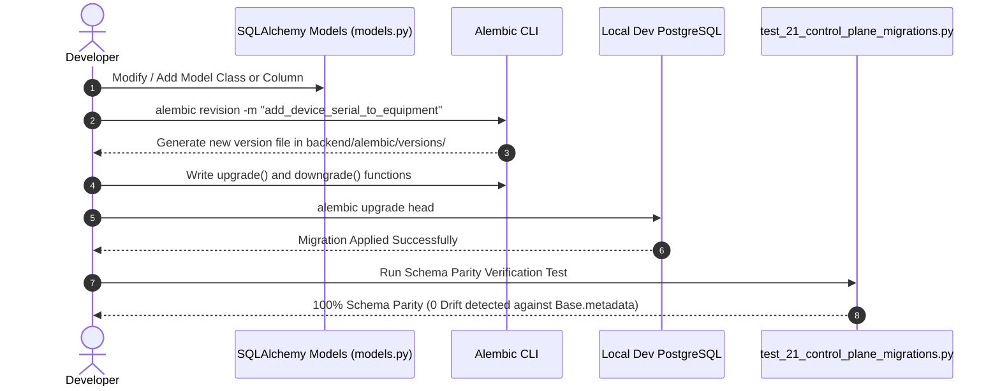

# Chapter 11: Developer & Local Environment Runbook
## The Complete Guide to Local Development, Hot-Reload, Test Data Seeding, Debugging & Migrations

---

## 1. Developer Environment Overview & Quickstart

While the Master Operations Runbook (Chapter 7) governs production clusters and high-availability operations, this runbook is **tailored specifically for software engineers building, testing, and debugging Avinya HMS locally**.

```mermaid
flowchart LR
    subgraph SETUP["1. Initial Setup"]
        CLONE["Clone Repo & Branch from 'dev'"]
        VENV["Python 3.11 Virtualenv (.venv)"]
        ENV_FILE["Copy .env.example to .env"]
        KEY_GEN["Generate Master Cryptographic Key"]
    end

    subgraph LOCAL_RUN["2. Local Dev Execution (Hot-Reload)"]
        COMPOSE_DEPS["Run Docker DB & Redis (Port 5432 & 6379)"]
        API_HOT["Uvicorn Hospital API (:8000 --reload)"]
        CP_HOT["Uvicorn Control Plane (:8080 --reload)"]
        VITE_DEV["Vite Frontend Console (:5173 HMR)"]
    end

    subgraph DEV_LOOP["3. Coding & Verification Loop"]
        MIGRATE["Alembic Migrations & Schema Parity"]
        SEED["Seed Synthetic Mock Data"]
        TEST["Run Pytest Target Suites"]
        SAST["Pyflakes & Bandit Security Checks"]
    end

    SETUP --> LOCAL_RUN --> DEV_LOOP
```



---

## 2. Prerequisites & Machine Setup

### Required Tooling:
- **Python:** `3.11.x` (64-bit). *(Do not use Python 3.12+ yet; binary wheels for cryptography and psycopg2 are pinned to 3.11).*
- **Node.js:** `v20.x` or `v22.x` LTS.
- **Docker Desktop / Podman:** Required for running local PostgreSQL 17 and Redis 8 instances.
- **Git:** Configured with your corporate credentials and GPG signing keys.

---

## 3. Step-by-Step Initial Workspace Setup

### 3.1 Clone & Branching Discipline
Always branch off the `dev` branch for new features and bug fixes:
```bash
git checkout dev
git pull origin dev
git checkout -b feature/your-feature-name
```

### 3.2 Python Virtual Environment (.venv) Setup

#### On Windows (PowerShell):
```powershell
# 1. Create a dedicated Python 3.11 virtual environment
python -m venv .venv

# 2. Allow local PowerShell script execution (if restricted)
Set-ExecutionPolicy -ExecutionPolicy RemoteSigned -Scope Process

# 3. Activate the virtual environment
.\.venv\Scripts\Activate.ps1

# 4. Upgrade pip and setuptools to pinned version
python -m pip install --upgrade pip "setuptools==84.0.0"

# 5. Install all developer and testing dependencies
pip install -r requirements-dev.txt
```

#### On Linux / macOS (Bash / Zsh):
```bash
python3.11 -m venv .venv
source .venv/bin/activate
pip install --upgrade pip "setuptools==84.0.0"
pip install -r requirements-dev.txt
```

### 3.3 Generating Local Environment Configuration (`.env`)
1. **Copy the example configuration:**
   ```bash
   cp .env.example .env
   ```
2. **Generate a fresh cryptographic master key for envelope encryption:**
   ```bash
   python -m backend.scripts.generate_key
   ```
   *Output:*
   ```text
   Generated SECRET_KEY: 8f9b2d4e6a1c7e5f3b9a0c2d4e6f8a1b...
   ```
3. Open `.env` and replace the placeholder `SECRET_KEY` and `MASTER_KEY` with the generated 256-bit entropy token. Keep `ENVIRONMENT=development` to enable Swagger UI documentation at `/docs`.

> [!TIP]
> **Host Networking vs. Docker Container Networking:**
> - When running native Python commands (like Uvicorn or `python -m backend.scripts.bootstrap`) on your host machine while database services run in Docker, your local scripts connect to Docker's published ports via `127.0.0.1` (`localhost`).
> - The codebase includes automatic host fallback in `backend/core/config.py`: if `POSTGRES_HOST` or `REDIS_HOST` are set to `db` or `redis` and cannot be resolved in host DNS, the runtime automatically connects to `127.0.0.1`.
> - If you run the entire stack within Docker (`docker compose up -d`), Docker Compose automatically routes containers to `db` and `redis` over its internal bridge network.

---

## 4. Running the Stack Locally in Development Mode

### Method A: Hybrid Native Development (Recommended for Coding Speed)
The fastest developer experience runs PostgreSQL and Redis in lightweight Docker containers while running the Python FastAPI apps natively with hot-reload:

```bash
# 1. Start background PostgreSQL 17 and Redis 8 services in Docker:
docker compose up -d db redis

# 2. Initialize local database schemas and seed catalogs:
python -m backend.scripts.bootstrap

# 3. Start the Hospital Tenant API with auto-reload (Terminal 1):
uvicorn backend.main:app --host 127.0.0.1 --port 8000 --reload

# 4. Start the Nexus Fleet Control Plane with auto-reload (Terminal 2):
uvicorn backend.control_plane.app:app --host 127.0.0.1 --port 8080 --reload

# 5. Start the Native HL7 v2 MLLP Socket Listener on port 2575 (Terminal 3):
python -m backend.domains.integrations.listener

# 6. Start the Background Queue Worker (Terminal 4):
python -m backend.worker
```

### Method B: Full Docker Compose Development
If you prefer running the entire system inside Docker with code volumes mounted:
```bash
docker compose up -d --build
```
- In development mode, files in `backend/` are live-mounted into the containers. Any Python code changes trigger immediate Uvicorn reload.

### Method C: Frontend UI Development (Hot Module Replacement)
To develop the Nexus Control Plane React console:
```bash
cd onboarding-ui
npm install
npm run dev
```
- The Vite dev server boots on `http://localhost:5173`.
- Any changes in React components (`src/views/`, `src/components/`) reflect instantly in the browser without reloading the page.

---

## 5. Local Developer Endpoints & Swagger UI

In development mode (`ENVIRONMENT=development`), interactive OpenAPI documentation is automatically enabled:

| Application | Local URL | Description & Credentials |
| :--- | :--- | :--- |
| **Hospital API Swagger UI** | `http://127.0.0.1:8000/docs` | Interactive API explorer for all 26 clinical domains. |
| **Hospital API ReDoc**      | `http://127.0.0.1:8000/redoc`| Clean architectural schema documentation. |
| **Control Plane Swagger UI**| `http://127.0.0.1:8080/docs` | Fleet provisioning, operator auth, and billing APIs. |
| **Control Plane Console**   | `http://127.0.0.1:8080/`     | React 18 visual onboarding portal & pricing simulator. |
| **Vite Dev Server (Frontend)**| `http://127.0.0.1:5173/`   | Live Vite HMR development server. |
| **MLLP Lab Analyzer Socket**| `tcp://127.0.0.1:2575`       | Raw TCP socket receiving HL7 v2 `ORU^R01` messages. |

---

## 6. Database & Migration Workflows for Developers



### 6.1 Creating a New Alembic Migration:
When you modify or create SQLAlchemy models in `backend/domains/<domain>/models.py`:
1. **Generate a migration stub:**
   ```bash
   alembic revision -m "describe_your_change"
   ```
2. **Author the migration:**
   Open the generated file in `backend/alembic/versions/`. Ensure both `upgrade()` and `downgrade()` are completely implemented.
3. **Verify Schema Parity against Metadata:**
   Avinya HMS includes an automated schema diff detector that compares your Alembic migrations against `Base.metadata`. **Your pull request will be rejected by CI if schema parity fails**:
   ```bash
   python -m pytest tests/test_21_control_plane_migrations.py
   ```
   If there is zero schema drift, the test passes with flying colors.

### 6.2 Resetting the Local Dev Database to a Blank Slate:
If your local development database becomes cluttered or corrupted with test data:
```bash
# Drop and rebuild local databases and seed fresh master catalogs:
python -m backend.scripts.bootstrap --reset
```

---

## 7. Seeding Mock Data & Testing Workflows

### 7.1 Creating a Local Control Plane Superadmin Operator & MFA Sign-In:

#### Step 1: Provision the Operator Account
To create a named operator in the Control Plane database:
```bash
python -m backend.scripts.create_control_plane_operator \
  --email "admin@avinya-hms.com" \
  --password "AdminPassword123!" \
  --role "superadmin"
```

#### Step 2: Access the Nexus Web Console
Open **`http://localhost:8080`** in your browser. Enter your credentials (`admin@avinya-hms.com` and `AdminPassword123!`) and click **Continue securely**.

#### Step 3: Completing Initial MFA Enrollment
Because Avinya enforces zero-trust operator access, every operator requires RFC 6238 TOTP Multi-Factor Authentication. On your first sign-in, the console presents:
> *"Set up an authenticator app, then enter its current six-digit code."*

Along with an **Authenticator secret** (e.g. `45Y63XXTZNWQ47GN...`).

To generate the required six-digit code:
* **Option A: Built-in CLI Tool (Fastest for Developers):**
  Open your terminal and run:
  ```bash
  python -m backend.scripts.totp --operator admin@avinya-hms.com
  # Or pass the secret string copied from the browser screen:
  python -m backend.scripts.totp 45Y63XXTZNWQ47GN...
  ```
  *Output:*
  ```text
  Operator 'admin@avinya-hms.com' Authenticator Code: 384910 (valid for 25s)
  ```
* **Option B: Mobile Authenticator App:**
  Open Google Authenticator, Microsoft Authenticator, 1Password, or Bitwarden on your phone. Select **Add Account ➔ Enter code manually**, paste the **Authenticator secret**, and save.

Type the 6-digit code into the **Authenticator code** box and click **Continue securely**. The console authenticates your session and opens the full **Nexus Multi-Tenant Fleet Dashboard**.

### 7.2 Seeding Synthetic Clinical & Hospital Data:
To populate your local tenant database with synthetic patients, doctors, wards, beds, and medication batches:
```bash
python -m backend.scripts.seed --tenant "default"
```

### 7.3 Simulating Laboratory Analyzer HL7 Messages (Port 2575):
You can test the native HL7 v2 MLLP receiver without physical laboratory hardware using Python:
```python
import socket

# Minimal Lower Layer Protocol (MLLP) framing: \x0b ... \x1c\x0d
VT = b"\x0b"
FS_CR = b"\x1c\x0d"

oru_message = (
    "MSH|^~\\&|ROCHE_COBAS|LAB|AVINYA|HOSP|20261026010000||ORU^R01|MSG001|P|2.3.1\r"
    "PID|1||MRN-202610-00412^^^AVINYA||SHARMA^RAJESH\r"
    "OBR|1|ORD-101|ROCHE-101|SERUM_ELECTROLYTES\r"
    "OBX|1|NM|K+^Potassium|1|6.5|mEq/L|3.5-5.0|HH|||F\r"
)

sock = socket.socket(socket.AF_INET, socket.SOCK_STREAM)
sock.connect(("127.0.0.1", 2575))
sock.sendall(VT + oru_message.encode("utf-8") + FS_CR)
ack_response = sock.recv(1024)
print("Received ACK from Avinya HMS:", ack_response)
sock.close()
```

---

## 8. Code Quality, Static Analysis & Testing Discipline

Before opening a pull request or pushing to `dev`, developers must execute the local quality verification checklist:

### 8.1 Run Targeted Domain Tests
```bash
# Run tests for the specific domain you modified:
python -m pytest tests/test_48_cpoe_order_sets_news2_and_delta_checks.py
```

### 8.2 Run Static Analysis (Pyflakes)
Verify zero undefined names or broken imports:
```bash
python -m pyflakes backend/
```
*Expected Result:* Zero undefined names.

### 8.3 Run Security Analysis (Bandit)
Ensure your changes do not introduce security flaws or SQL injection risks:
```bash
python -m bandit -r backend/ -ll
```
*Expected Result:* `No issues identified (0 High, 0 Medium)`.

### 8.4 Run Strict Dependency Vulnerability Audit
```bash
python -m pip_audit -r requirements.txt
```
*Expected Result:* `No known vulnerabilities found`.

---

## 9. Developer Troubleshooting & Tips

### Tip 1: Windows CRLF vs. Linux LF Git Conflicts
When editing on Windows, Git may convert line endings to CRLF, which can make git diffs look cluttered.
- **Fix:** Keep Git configured to handle line endings transparently:
  ```bash
  git config --global core.autocrlf true
  ```

### Tip 2: Inspecting Database Queries in Real-Time
To see exact SQL statements and execution times in your terminal while developing:
- Set `SQL_ECHO=True` in your local `.env`.
- SQLAlchemy will log every `SELECT`, `INSERT`, `UPDATE`, and `FOR UPDATE NOWAIT` statement directly to your console.

### Tip 3: Testing Authentication Locally
When testing authenticated endpoints in Swagger UI or Postman:
1. Call `POST /api/identity/login` with email and password.
2. If MFA is enabled, call `POST /api/identity/mfa/verify` with the current TOTP token.
3. Copy the returned `access_token` and paste it into Swagger's **Authorize** button (`Bearer <token>`).

---

*For production deployment and cluster operations, refer to [Chapter 7: Master Operations Runbook](07_MASTER_OPERATIONS_RUNBOOK.md). For full navigation, return to the [Master Guide Index](README.md).*

