# Avinya HMS – Complete Enterprise Documentation Suite
## The Definitive Guide to Architecture, Clinical Workflows, Operations & Troubleshooting

Welcome to the **Complete Enterprise Documentation Suite** for **Avinya HMS**.

This guide is designed for anyone—software engineers, DevOps practitioners, hospital IT directors, clinical specialists, compliance auditors, or support engineers—who needs to understand **everything about this platform from the ground up, without ever having to read through the source code**.

Whether you need to understand how the system manages patient safety, how high-concurrency bed reservations operate under the hood, how multi-tenant databases are isolated, how to provision a new hospital in 60 seconds, or **how to triage and resolve production errors**, this guide covers it comprehensively.

---

## Guide Architecture & Document Index

```
docs/complete_guide/
├── README.md                                          <-- You are here (Master Index & Reading Paths)
├── 01_PROJECT_OVERVIEW_AND_CONCEPTS.md                <-- What Avinya HMS is, why it was built, and core principles
├── 02_ARCHITECTURE_AND_SYSTEM_DESIGN.md               <-- Technical topology, database-per-tenant, and infrastructure
├── 03_END_TO_END_CLINICAL_AND_BUSINESS_WORKFLOWS.md   <-- Detailed walkthrough of all 26 hospital domains & safety gates
├── 04_OPERATOR_AND_ADMINISTRATOR_MANUAL.md            <-- Control plane, tenant onboarding, backups, and migrations
├── 05_TROUBLESHOOTING_ERROR_HANDLING_AND_RUNBOOKS.md  <-- Error codes, root causes, diagnostics & emergency runbooks
├── 06_SECURITY_PRIVACY_AND_COMPLIANCE.md              <-- Envelope encryption, DPDP Act 2023, ABDM, NHCX & audit
├── 07_MASTER_OPERATIONS_RUNBOOK.md                    <-- Daily maintenance SOPs, PostgreSQL tuning, Redis & SLAs
├── 08_API_AND_INTEGRATION_REFERENCE.md                <-- Native HL7 v2 MLLP (:2575), FHIR R4, ABDM & Webhooks
├── 09_DATABASE_SCHEMA_AND_DATA_DICTIONARY.md          <-- 70+ tables, constraints, fields & sandbox classification
├── 10_TESTING_QA_AND_RELEASE_GOVERNANCE.md            <-- 441 tests (100% green), Bandit SAST, pip-audit, and release gates
└── 11_DEVELOPER_AND_LOCAL_ENVIRONMENT_RUNBOOK.md      <-- Local dev setup, hot-reload, Alembic migrations, test data seeding & debugging
```

---

## Role-Based Reading Paths

Different stakeholders require different entry points into the system documentation. Choose the path that matches your responsibility:

### 1. New Software Engineers & Architects
- **Step 1:** Read [`01_PROJECT_OVERVIEW_AND_CONCEPTS.md`](01_PROJECT_OVERVIEW_AND_CONCEPTS.md) for architectural mission and healthcare vocabulary.
- **Step 2:** Study [`02_ARCHITECTURE_AND_SYSTEM_DESIGN.md`](02_ARCHITECTURE_AND_SYSTEM_DESIGN.md) to understand the dual-ASGI engine (Hospital Engine vs. Control Plane) and database pooling.
- **Step 3:** Explore [`03_END_TO_END_CLINICAL_AND_BUSINESS_WORKFLOWS.md`](03_END_TO_END_CLINICAL_AND_BUSINESS_WORKFLOWS.md) to understand domain logic, CPOE order sets, NEWS2 scoring, and BCMA verification.
- **Step 4:** Review [`06_SECURITY_PRIVACY_AND_COMPLIANCE.md`](06_SECURITY_PRIVACY_AND_COMPLIANCE.md) for cryptographic boundaries (AES-256-GCM envelope encryption).
- **Step 5:** Dive into [`11_DEVELOPER_AND_LOCAL_ENVIRONMENT_RUNBOOK.md`](11_DEVELOPER_AND_LOCAL_ENVIRONMENT_RUNBOOK.md) to launch the dual-ASGI servers with hot-reload, author Alembic migrations, seed test data, and run the pre-commit test suite.

### 2. DevOps, Site Reliability & Platform Operators
- **Step 1:** Read [`02_ARCHITECTURE_AND_SYSTEM_DESIGN.md`](02_ARCHITECTURE_AND_SYSTEM_DESIGN.md) for network ingress, Traefik routing, PostgreSQL 17, and Redis 8 infrastructure.
- **Step 2:** Study [`04_OPERATOR_AND_ADMINISTRATOR_MANUAL.md`](04_OPERATOR_AND_ADMINISTRATOR_MANUAL.md) for zero-touch provisioning, Alembic migrations, sandbox sanitization, and automated S3 restore drills.
- **Step 3:** Bookmark and master [`05_TROUBLESHOOTING_ERROR_HANDLING_AND_RUNBOOKS.md`](05_TROUBLESHOOTING_ERROR_HANDLING_AND_RUNBOOKS.md) for incident response, database deadlock clearance, and queue triage.

### 3. Hospital IT Directors & Clinical Operations Leads
- **Step 1:** Read [`01_PROJECT_OVERVIEW_AND_CONCEPTS.md`](01_PROJECT_OVERVIEW_AND_CONCEPTS.md) for high-level benefits and comparison against legacy monolithic software.
- **Step 2:** Deep-dive into [`03_END_TO_END_CLINICAL_AND_BUSINESS_WORKFLOWS.md`](03_END_TO_END_CLINICAL_AND_BUSINESS_WORKFLOWS.md) to understand patient journeys, 3-tier discharge clearance, narcotics vault rules, and midnight census billing.
- **Step 3:** Review [`06_SECURITY_PRIVACY_AND_COMPLIANCE.md`](06_SECURITY_PRIVACY_AND_COMPLIANCE.md) for DPDP Act 2023, ABDM M1-M3, and NABH/JCI accreditation indicators.

### 4. Technical Support & L2/L3 Helpdesk
- **Primary Reference:** [`05_TROUBLESHOOTING_ERROR_HANDLING_AND_RUNBOOKS.md`](05_TROUBLESHOOTING_ERROR_HANDLING_AND_RUNBOOKS.md).
- Search by HTTP error code (`401`, `403`, `409`, `422`, `500`) or symptom (stuck bed, BCMA barcode scan failure, laboratory analyzer disconnection) to find exact step-by-step resolution procedures.

---

## Executive Summary of Avinya HMS

```mermaid
flowchart LR
    subgraph PILLAR_1["1. Clinical Safety"]
        direction TB
        CPOE["CPOE Order Sets"]
        NEWS2["NEWS2 Early Warning"]
        BCMA["BCMA 5-Rights Bedside"]
        VAULT["Controlled Substances Vault"]
    end

    subgraph PILLAR_2["2. High Performance"]
        direction TB
        DB_ISO["Physical DB-per-Tenant"]
        POOL["Dynamic Engine Pool"]
        ATOMIC["FOR UPDATE NOWAIT Locks"]
        WORKER["Dry-Run Queue Worker"]
    end

    subgraph PILLAR_3["3. Revenue & Interop"]
        direction TB
        CDM["Multi-Tariff CDM Engine"]
        CENSUS["Midnight Census Billing"]
        ABDM["ABDM M1-M3 & NHCX"]
        MLLP["Native HL7 v2 MLLP"]
    end

    PILLAR_1 --- PILLAR_2 --- PILLAR_3
```



- **Architecture:** Modular Monolith with an Autonomous SaaS Control Plane.
- **Multi-Tenancy:** Physical Database-per-Tenant (`hms_{tenant_slug}`) with centralized fleet orchestration (`hms_control_plane`).
- **Core Technologies:** Python 3.11, FastAPI, SQLAlchemy 2.1, PostgreSQL 17, Redis 8, React 18, Vite 8, Docker Compose.
- **Scale:** 26 Clinical & Operational Domains, 70+ Relational Tables, 421 Passing Automated Integration Tests, 0 Known Vulnerabilities.

---

*Proceed to [Chapter 1: Project Overview & Conceptual Foundation](01_PROJECT_OVERVIEW_AND_CONCEPTS.md) to begin exploring the system.*
